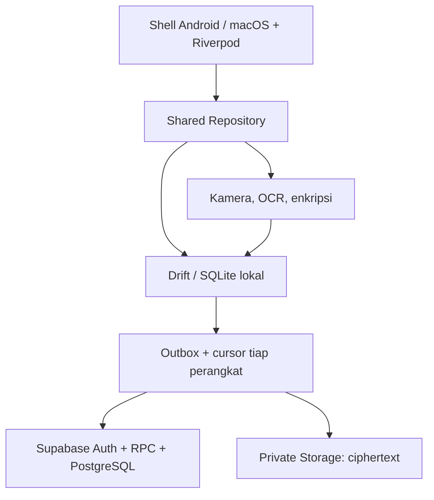

# Product Requirements Document: Anak Kost

**Nama produk:** Anak Kost, nama sementara  
**Versi dokumen:** 1.1, Android + macOS  
**Tanggal:** 10 Oktober 2026  
**Status:** Spesifikasi untuk development bertahap  
**Platform:** Android dan macOS, satu proyek Flutter dengan dua build aplikasi  
**Pengguna:** Satu pengguna pribadi  
**Perangkat penerimaan utama:** Samsung Galaxy S24+ dan MacBook Air M2  
**Bahasa antarmuka:** Bahasa Indonesia

> Dokumen ini menetapkan perilaku produk, model data, arsitektur, kriteria penerimaan, dan urutan implementasi. Angka performa dan estimasi adalah target proyek, bukan hasil pengujian. Referensi teknis resmi tersedia di bagian 10.7.

**Perubahan versi 1.1:** dua perangkat dapat digunakan bersamaan oleh pemilik yang sama; UI mobile dan desktop dibedakan; backend tetap satu Supabase project. Dukungan macOS, distribusi kunci antarperangkat, konflik offline, dan pengujian dua arah masuk Must. Versi ini menggantikan pembatasan satu perangkat aktif pada versi 1.0.

## Asumsi

| ID | Asumsi dan keputusan awal |
| --- | --- |
| A01 | Pengguna tinggal di kost selama magang dan mencatat kebutuhannya sendiri. Tidak ada peran admin, keluarga, teman sekamar, atau organisasi. |
| A02 | Satu pengguna pribadi memakai Galaxy S24+ dan MacBook Air M2 secara bersamaan. Kedua perangkat terdaftar aktif, masing-masing memiliki database lokal dan outbox sendiri; satu Supabase project menyatukan data. |
| A03 | Mata uang hanya IDR. Nominal uang disimpan sebagai integer rupiah tanpa pecahan, bukan floating point. |
| A04 | Zona waktu awal `Asia/Jakarta`, dapat diubah. Tanggal lokal menentukan bulan budget dan jatuh tempo; timestamp sinkronisasi memakai UTC. |
| A05 | Setiap perangkat bekerja offline setelah setup; perubahan terlihat di perangkat lain setelah keduanya tersinkron. Penautan perangkat kedua dan pemulihan cloud membutuhkan internet serta recovery secret. |
| A06 | Supabase digunakan sebagai backend pribadi. Akun pemilik dibuat saat setup; pendaftaran publik dinonaktifkan setelah akun tersedia. Tidak ada feed publik atau berbagi dokumen otomatis. |
| A07 | Android memakai APK pribadi; macOS memakai build `.app` pribadi dari proyek Flutter yang sama. Tidak ada publikasi Play Store/App Store, iklan, monetisasi, atau analitik pihak ketiga pada cakupan ini. |
| A08 | Spesifikasi layar AMOLED 120Hz, kamera 50MP, biometrik, dan One UI mengikuti perangkat yang disebut pengguna. Aplikasi tetap mengikuti kemampuan yang benar-benar tersedia pada API dan pengaturan perangkat. |
| A09 | Saldo, harga, stok, dan jadwal berasal dari input pengguna. Tidak ada koneksi perbankan, pembayaran nyata, pembacaan SMS, atau scraping aplikasi lain. |
| A10 | OCR berjalan di perangkat dan menghasilkan draf yang wajib diperiksa. Identifikasi item struk lebih sulit daripada total; parser item rinci ditingkatkan setelah OCR dasar stabil. |
| A11 | Stok memakai satu unit dasar per barang. Konversi kemasan dilakukan eksplisit, misalnya satu bungkus beras = 5.000 gram. Tidak ada konversi unit otomatis berdasarkan tebakan OCR. |
| A12 | Pengembangan dilakukan solo dengan bantuan AI, sekitar 15 jam fokus per minggu. Estimasi mencakup pengujian dan integrasi, dengan cadangan 20%. |
| A13 | Dokumen identitas dan seluruh lampiran dienkripsi sebelum disimpan atau diunggah. Metadata keuangan biasa di PostgreSQL tetap terlihat oleh pengelola backend; dokumen sensitif memakai metadata terenkripsi. |
| A14 | Pencarian berbasis gambar berarti galeri visual dan pencarian item melalui foto pada versi awal. Pencarian dengan foto contoh untuk menemukan gambar serupa adalah fitur lanjutan, bukan klaim kemampuan MVP. |
| A15 | MacBook Air M2 menjadi perangkat desktop Apple Silicon: keyboard, trackpad, jendela yang dapat diubah ukurannya, dan Touch ID bila tersedia/terkonfigurasi. Tidak mengasumsikan layar Mac 120Hz. |
| A16 | Kamera/scan fisik utama berada di S24+. macOS Must mendukung impor gambar/PDF dan OCR gambar lokal; kamera Mac serta Continuity Camera adalah Could, bukan syarat pencatatan. |
| A17 | PIN, unlock biometrik, ukuran jendela, cache lampiran, cursor, dan delivery notifikasi bersifat per perangkat. Transaksi, stok, agenda, tagihan, dokumen, budget, serta aturan pengingat merupakan data bersama. |
| A18 | Setup workspace dilakukan di satu perangkat terlebih dahulu. Perangkat kedua mengambil workspace yang sudah ada; tidak membuat master key/crypto context baru untuk data yang sama. |

## 1. Ringkasan produk dan tujuan

### 1.1 Masalah yang diselesaikan

Pengeluaran harian, stok kebutuhan, jadwal magang, tagihan kost, dan dokumen biasanya tersebar di beberapa tempat. Pengguna sulit menjawab pertanyaan sederhana: uang bulan ini tersisa berapa, barang apa yang perlu dibeli, pekerjaan mana yang harus selesai, dan apakah kost sudah dibayar.

Anak Kost menyatukan pencatatan tersebut dalam aplikasi pribadi. Interaksi utamanya singkat: mencatat pengeluaran, mengambil foto bukti, menandai kebutuhan belanja, memeriksa jadwal hari ini, dan melihat kewajiban terdekat.

Di S24+, fokusnya pencatatan cepat, kamera, dan pengingat saat bepergian. Di MacBook, fokusnya pemeriksaan laporan, input dengan keyboard, pengelolaan stok, agenda, serta dokumen. Keduanya menjalankan empat modul yang sama dan mengakses satu dataset milik akun yang sama. “Dua aplikasi” berarti dua hasil build dari satu produk Flutter, dengan domain/repository bersama dan shell UI sesuai platform.

### 1.2 Tujuan produk

| Tujuan | Perilaku yang ingin dicapai | Indikator penerimaan |
| --- | --- | --- |
| Kontrol pengeluaran | Pengguna melihat uang, pengeluaran, dan batas budget tanpa menghitung manual. | Pengeluaran manual sederhana dapat dicatat dalam target 15 detik setelah pengguna terbiasa. |
| Mengurangi kelupaan | Tagihan, tugas, dan stok rendah muncul di Dashboard serta pengingat. | Seluruh kewajiban aktif terlihat walau notifikasi perangkat dinonaktifkan. |
| Menjaga keteraturan | Foto bukti dan dokumen terhubung ke konteksnya. | Bukti transaksi dapat dibuka langsung dari transaksi; dokumen dapat ditemukan lewat kategori. |
| Tetap berguna offline | Pencatatan tidak bergantung pada koneksi. | Empat modul utama dapat dibaca dan diubah dalam mode pesawat setelah setup. |
| Mudah dipelihara sendiri | Modul dibangun dan diuji secara bertahap. | Setiap milestone menghasilkan APK/build macOS yang sesuai cakupan fase dan migration terdokumentasi. |
| Konsistensi dua perangkat | Input di ponsel dapat diperiksa di Mac dan sebaliknya. | Satu operasi hanya berpengaruh sekali; perubahan tanpa konflik diterima perangkat lain dalam target 10 detik ketika kedua aplikasi aktif, online, dan backend sehat. |

### 1.3 Ruang lingkup

**Termasuk:** pencatatan pribadi di Android dan macOS, UI adaptif sesuai perangkat, budget, stok, belanja, agenda fleksibel, tagihan berulang, dokumen, OCR per platform, foto/impor gambar, pengingat lokal, Supabase, sinkronisasi dua perangkat, backup, dan keamanan lokal.

**Di luar versi 1:** akuntansi bisnis, pajak, multiuser, pembayaran otomatis, integrasi bank, kolaborasi magang, pelacakan lokasi terus-menerus, aplikasi iOS, dan AI chatbot umum. AI digunakan untuk membantu development; aplikasi tidak harus memiliki fitur generatif.

### 1.4 Prinsip pengalaman pengguna

- Input cepat; detail tambahan seperti foto dan catatan bersifat opsional, kecuali data minimum yang diperlukan.
- Simpan ke perangkat terlebih dahulu. Status sinkronisasi tidak menghalangi pencatatan.
- Semua saran OCR dan automasi memiliki tahap konfirmasi untuk perubahan uang atau stok.
- Informasi sensitif tidak tampil di widget atau notifikasi secara default.
- Bahasa sederhana: “Sisa budget”, “Belum dibayar”, “Stok menipis”, dan “Menunggu sinkronisasi”.

## 2. Persona pengguna dan user stories

### 2.1 Persona utama

| Aspek | Deskripsi |
| --- | --- |
| Profil | Mahasiswa yang tinggal sementara di kost untuk menjalani magang. |
| Rutinitas | Bekerja pada hari tertentu, memiliki tugas dan tenggat, membeli kebutuhan harian, serta membayar kewajiban rutin. |
| Kondisi | Waktu pencatatan terbatas; koneksi bisa terputus; menggunakan S24+ untuk aktivitas mobile dan MacBook Air M2 untuk pengelolaan desktop. |
| Kebutuhan | Mengetahui kondisi hari ini dalam satu halaman dan menyimpan bukti tanpa membuat folder manual. |
| Hambatan | Lupa mencatat transaksi, salah memperkirakan stok, struk sulit dibaca, dan takut dokumen pribadi bocor. |
| Ukuran keberhasilan | Aplikasi tetap dipakai karena cepat, datanya dapat dipercaya, dan membantu persiapan harian. |

### 2.2 User stories dan kriteria penerimaan

| ID | User story | Kriteria penerimaan utama |
| --- | --- | --- |
| US01 | Sebagai pengguna, saya ingin mencatat pengeluaran makan dari dompet tunai. | Nominal, kategori, dompet, dan waktu tersimpan offline; saldo dan budget berubah sekali. |
| US02 | Saya ingin memindahkan uang dari bank ke e-wallet. | Dua mutasi dompet terbentuk atomik; transfer tidak dihitung sebagai pemasukan atau pengeluaran. |
| US03 | Saya ingin tahu apakah budget makan hampir habis. | Pengeluaran dibandingkan dengan budget bulan yang sama; peringatan 80% dan 100% tidak berulang setiap aplikasi dibuka. |
| US04 | Saya ingin menabung untuk target tertentu. | Alokasi tabungan tidak menaikkan pengeluaran; progres berasal dari alokasi bersih yang sah. |
| US05 | Saya ingin mengetahui beras yang tersisa. | Stok dihitung dari mutasi barang dalam unit dasar; riwayat pemakaian dapat diperiksa. |
| US06 | Saya ingin pembelian sabun menambah stok dan mencatat biaya. | Keduanya dilakukan hanya setelah konfirmasi, dalam satu operasi; retry tidak membuat duplikat. |
| US07 | Saya ingin melihat agenda magang besok dan tugas yang terlambat. | Agenda menggunakan zona waktu yang dipilih; status terlambat dihitung dari tenggat dan status tugas. |
| US08 | Saya ingin mengubah jadwal magang menjadi jadwal kuliah. | Nama dan jenis kalender dapat diubah tanpa kehilangan tugas atau merusak occurrence lama. |
| US09 | Saya ingin diingatkan membayar kost setiap bulan. | Jatuh tempo mengikuti aturan pengulangan; lunas bulan ini tidak melunasi bulan berikutnya. |
| US10 | Saya ingin menandai tagihan lunas beserta bukti transfer. | Pembayaran terhubung ke satu transaksi; Dashboard, saldo, dan status tagihan tetap konsisten. |
| US11 | Saya ingin menyimpan kontrak kost dan KTP dengan aman. | Berkas dan metadata sensitif terenkripsi; membuka dokumen membutuhkan autentikasi ulang. |
| US12 | Saya ingin memotret struk agar transaksi terisi otomatis. | Sistem mengusulkan toko, tanggal, total, dan item yang berhasil dibaca; pengguna memeriksa sebelum menyimpan. |
| US13 | Saya ingin mencatat ketika tidak ada internet. | Operasi tersimpan lokal dan dapat dibaca kembali setelah aplikasi dimatikan; sinkronisasi dilanjutkan saat tersedia. |
| US14 | Saya ingin pindah ponsel tanpa kehilangan data. | Backup dapat dipulihkan; dokumen hanya dapat didekripsi dengan recovery key yang benar. |
| US15 | Saya ingin menemukan bukti pembelian melalui foto atau kategori. | Galeri lokal memfilter thumbnail, kategori, rentang tanggal, dan jenis lampiran; dokumen terkunci disembunyikan. |
| US16 | Saya ingin transaksi yang saya catat di S24+ muncul di MacBook. | Setelah sync, transaksi yang sama muncul dengan ID dan nominal yang sama; tidak ada duplikasi ledger atau lampiran. |
| US17 | Saya ingin memakai Mac untuk membuat budget dan agenda, kemudian melihatnya di ponsel. | Perubahan dua arah diterapkan lokal; ponsel menyesuaikan reminder setelah pull, tidak ketika Mac sekadar mengubah cache. |
| US18 | Saya ingin kedua perangkat tetap dipakai tanpa internet. | Data yang berbeda dapat digabung; edit terhadap row yang sama memerlukan resolusi bila bertentangan. Tidak ada last-write-wins diam-diam untuk uang. |
| US19 | Saya ingin mengelola data dengan keyboard dan trackpad. | Sidebar, tabel yang dapat diurutkan, fokus keyboard, dan shortcut bekerja; form tidak melebar memenuhi seluruh jendela. |
| US20 | Saya ingin dokumen yang dipotret di ponsel dapat dibuka dengan aman di Mac. | Ciphertext disinkron; Mac menggunakan master key workspace yang sama dengan proteksi Keychain lokal dan autentikasi vault. |

## 3. Daftar fitur per modul dengan prioritas MoSCoW

### 3.1 Definisi prioritas

| Prioritas | Arti dalam proyek |
| --- | --- |
| Must | Diperlukan sebelum MVP dua platform terintegrasi dinyatakan selesai. Boleh tersedia lebih awal dalam build internal per fase. |
| Should | Dibangun setelah Must stabil; bernilai tinggi untuk versi lanjutan 1.1. |
| Could | Opsional setelah penggunaan nyata membuktikan kebutuhannya. |
| Won't pada versi 1 | Sengaja tidak dibangun pada versi ini. |

### 3.2 Keuangan dan budgeting

| ID | Fitur | Prioritas | Spesifikasi |
| --- | --- | --- | --- |
| FIN01 | Pemasukan dan pengeluaran | Must | Nominal, tanggal/waktu, kategori, dompet wajib; toko, catatan, dan foto opsional. CRUD dengan pembatalan aman. |
| FIN02 | Dompet/rekening | Must | Tunai, e-wallet, bank; nama bebas, saldo awal, arsip, dan saldo berjalan dari ledger. |
| FIN03 | Transfer antar-dompet | Must | Dompet asal dan tujuan berbeda. Biaya transfer, bila ada, dicatat sebagai pengeluaran terpisah dalam operasi yang sama. |
| FIN04 | Kategori | Must | Kategori pemasukan/pengeluaran dapat dibuat dan diarsipkan. Kategori yang pernah dipakai tidak dihapus permanen. |
| FIN05 | Budget bulanan per kategori | Must | Satu batas nominal per kategori dan bulan. Tampilan terpakai, sisa, serta peringatan 80%/100%. |
| FIN06 | Target tabungan | Must | Nama, target nominal, target tanggal opsional, serta alokasi/tarik alokasi dari dompet. |
| FIN07 | Laporan dasar | Must | Pemasukan, pengeluaran, selisih, pengeluaran per kategori, grafik harian/bulanan dan filter dompet. |
| FIN08 | Foto bukti transaksi | Must | Lampiran dapat ditambah sebelum atau setelah transaksi. Galeri bukti terhubung ke transaksi asal. |
| FIN09 | Scan struk dasar | Must | OCR dan parser untuk total, tanggal, toko; daftar item hasil deteksi tetap dapat diperiksa/diedit. |
| FIN10 | Pengembalian dana | Should | Refund mengacu ke transaksi asal, mengembalikan saldo dan mengurangi penggunaan budget terkait. |
| FIN11 | Template transaksi dan salin budget | Should | Pengeluaran rutin dapat diisi cepat; penyalinan budget ke bulan berikutnya eksplisit. |
| FIN12 | Analisis pola dan proyeksi | Could | Proyeksi berdasarkan riwayat, ditandai sebagai perkiraan; tidak menjanjikan saldo masa depan. |
| FIN13 | Integrasi bank dan pembayaran | Won't | Aplikasi tidak menarik saldo bank atau melakukan transfer uang nyata. |

**Aturan bisnis uang:**

1. Satu transaksi adalah satu kejadian finansial. Satu atau beberapa `wallet_entries` menyatakan dampaknya ke dompet.
2. Pemasukan menghasilkan mutasi positif; pengeluaran menghasilkan mutasi negatif. Transfer memiliki dua mutasi sama besar berlawanan tanda. Saldo awal menggunakan transaksi `opening`, bukan pemasukan.
3. `saldo_dompet = SUM(wallet_entries.amount_rp)` untuk transaksi aktif. Saldo tidak disimpan sebagai nilai otoritatif yang dapat diedit terpisah.
4. `penggunaan_budget = pengeluaran kategori - refund terkait` pada bulan lokal transaksi. Transfer, saldo awal, koreksi saldo, dan alokasi tabungan dikecualikan.
5. Budget tidak otomatis berpindah antarbulan. Kategori tanpa budget ditampilkan sebagai “Belum diatur”, bukan batas nol. Sisa negatif ditampilkan sebagai “Melebihi Rp…”.
6. Target tabungan adalah pembagian tujuan dari uang yang sudah dimiliki. Alokasi tidak memindahkan uang nyata atau menggandakan saldo. Alokasi baru dibatasi saldo positif yang belum dialokasikan; pengeluaran setelahnya dapat menimbulkan peringatan alokasi tidak lagi tercukupi.
7. Saldo negatif tetap boleh terjadi karena pengguna mungkin belum mencatat pemasukan. Tampilkan peringatan, tanpa memblokir transaksi pengeluaran yang benar-benar terjadi.
8. Nominal transaksi harus lebih dari nol kecuali tipe koreksi yang memakai mutasi bertanda. Format input `15.000` disimpan sebagai `15000`; perhitungan memakai integer.
9. Perubahan transaksi yang sudah tersimpan wajib memperbarui header dan mutasi dompet secara atomik. Pembatalan mempertahankan riwayat dengan `status=void`, mengeluarkannya dari perhitungan, dan membatalkan hubungan pembayaran terkait.
10. Laporan periode memakai tanggal transaksi, bukan tanggal unggah. Penggantian zona waktu tidak menggeser `local_date` transaksi lama secara otomatis.

**Contoh penerimaan:** saldo bank Rp1.000.000 dan e-wallet Rp0. Transfer Rp200.000 dengan biaya Rp2.500 menghasilkan saldo bank Rp797.500 dan e-wallet Rp200.000. Laporan hanya menambah pengeluaran biaya Rp2.500.

### 3.3 Belanja dan stok kebutuhan

| ID | Fitur | Prioritas | Spesifikasi |
| --- | --- | --- | --- |
| STK01 | Daftar belanja | Must | Beberapa daftar; item bebas atau terhubung ke inventaris; jumlah, estimasi harga, toko opsional, dan status beli. |
| STK02 | Inventaris barang | Must | Nama, kategori, unit dasar, lokasi penyimpanan opsional, ambang minimum, serta foto thumbnail. |
| STK03 | Mutasi stok | Must | Tambah, pakai, koreksi, dan stok awal. Kuantitas bersifat desimal tetap dengan alasan perubahan. |
| STK04 | Pengingat stok minimum | Must | Stok sama dengan atau kurang dari ambang ditandai; tombol “Tambah ke belanja” dengan pemeriksaan duplikat. |
| STK05 | Riwayat harga | Must | Harga total, jumlah dalam unit dasar, toko dan tanggal; harga per unit dihitung untuk pembandingan. |
| STK06 | Konfirmasi belanja selesai | Must | Opsi eksplisit: catat pengeluaran, tambah stok, simpan harga; semua terpilih secara konsisten dalam satu operasi. |
| STK07 | Saran dari struk | Should | Pengguna mencocokkan item OCR dengan barang lokal; tidak menambah stok dari kemiripan nama tanpa konfirmasi. |
| STK08 | Kedaluwarsa dan batch | Could | Tambahan skema batch untuk barang mudah rusak; tidak sekadar satu tanggal untuk banyak pembelian. |
| STK09 | Barcode | Could | Scan sebagai input kode barang; lookup katalog eksternal tidak menjadi ketergantungan wajib. |
| STK10 | Pemesanan toko otomatis | Won't | Aplikasi tidak membeli barang dari marketplace. |

**Aturan bisnis stok:**

- Stok merupakan jumlah `inventory_movements` aktif, bukan field angka yang diperbarui dengan last-write-wins.
- Mutasi setelah tersimpan bersifat append-only. Kesalahan dibatalkan lewat mutasi pembalik yang mengacu ke mutasi asal, lalu catat mutasi baru bila perlu.
- Penggunaan tidak boleh menghasilkan stok negatif. Jika kenyataan berbeda, pengguna harus membuat koreksi dengan alasan dahulu. Validasi dilakukan lokal dan server saat replay.
- MVP mendukung `pcs`, `g`, `ml`, dan unit tambahan bernama pengguna. Barang beras dapat memakai gram; sabun batang memakai pcs. Tampilan boleh mengubah 5.000 g menjadi 5 kg, tetapi penyimpanan tetap gram.
- Harga per gram atau ml dihitung sebagai nilai desimal untuk tampilan; uang yang dibayarkan tetap integer rupiah.
- Perubahan unit dasar barang yang telah memiliki mutasi diblokir. Gunakan barang baru atau migrasi konversi terkonfirmasi pada versi lanjutan.
- Centang item belanja saja tidak otomatis mengurangi saldo atau menambah stok. Tindakan “Selesaikan pembelian” membuka konfirmasi harga dan kuantitas aktual.
- Harga struk dengan diskon/pajak global tidak dibagi ke stok secara diam-diam. Pengguna menerima harga yang tersedia atau mengisi harga efektif sendiri.
- Stok rendah hanya menghasilkan pengingat pada transisi normal → rendah, atau pengingat ulang yang dipilih. Penambahan stok membatalkan pengingat yang tidak lagi relevan.

**Contoh penerimaan:** beras awal 5.000 g, pemakaian 1.250 g, batas minimum 1.000 g menghasilkan stok 3.750 g tanpa peringatan. Pemakaian berikutnya 3.000 g menghasilkan stok 750 g dan satu peringatan. Retry sinkronisasi tidak mengurangi stok lagi.

### 3.4 Jadwal magang dan kegiatan

| ID | Fitur | Prioritas | Spesifikasi |
| --- | --- | --- | --- |
| SCH01 | Kalender kegiatan fleksibel | Must | Jenis `internship`, `study`, `personal`, `custom`; nama dan warna bebas. UI memakai istilah “Agenda”, bukan model data khusus magang. |
| SCH02 | Jadwal kerja berulang | Must | Hari dalam minggu, mulai/selesai, zona waktu, rentang berlaku, lokasi teks; preset hari kerja. |
| SCH03 | Agenda sekali jalan | Must | Judul, mulai/selesai, kalender, lokasi, catatan, dan pengingat opsional. |
| SCH04 | Tugas dan deadline | Must | Status belum mulai, dikerjakan, selesai; prioritas; due date/time; kaitan kalender atau agenda opsional. |
| SCH05 | Pengingat lokal | Must | Preset 10/30/60 menit sebelum agenda; deadline H-1 dan hari H; jadwal dapat diubah pengguna. |
| SCH06 | Tampilan hari/minggu | Must | Agenda hari ini, tugas terlambat, dan tampilan mingguan sederhana. |
| SCH07 | Pengecualian jadwal | Must | Batalkan atau ubah satu kejadian; ubah kejadian ini dan berikutnya dengan memisahkan seri. |
| SCH08 | Checklist subtugas | Should | Detail pekerjaan dibagi menjadi beberapa langkah tanpa sistem project management kompleks. |
| SCH09 | Catatan harian magang | Should | Catatan kegiatan, hasil, kendala, dan lampiran opsional. |
| SCH10 | Google Calendar/ekspor ICS | Could | Integrasi tambahan setelah model agenda stabil; arah sinkronisasi harus ditentukan dahulu. |
| SCH11 | Presensi otomatis/GPS terus aktif | Won't | Tidak melakukan pelacakan lokasi atau klaim bukti kehadiran otomatis. |

**Aturan jadwal:**

- Jadwal berulang mempertahankan jam dinding dan zona waktu asal; occurrence dikonversi ke UTC saat dijadwalkan.
- End harus setelah start; kegiatan melewati tengah malam memakai tanggal selesai berikutnya.
- Perubahan seri tidak mengubah agenda yang sudah berlalu. “Ini dan berikutnya” menutup seri lama dan membuat seri baru.
- Pengecualian tanggal spesifik, seperti libur, mengalahkan template mingguan. Jadwal bentrok diberi peringatan dan tetap bisa disimpan.
- Tugas selesai membatalkan pengingat deadline. Tugas terlambat adalah hasil hitung, bukan status yang disimpan permanen.
- Lokasi berupa teks dan tautan peta opsional. Membuka peta tidak memerlukan izin lokasi aplikasi.
- MVP tidak membutuhkan RRULE lengkap. Dukung hanya sekali, mingguan beberapa hari, dan interval yang disebut dalam UI. Aturan lain ditambahkan melalui migration.

### 3.5 Tagihan kost dan dokumen penting

| ID | Fitur | Prioritas | Spesifikasi |
| --- | --- | --- | --- |
| BIL01 | Template tagihan | Must | Kost, listrik, Wi-Fi, pulsa, dan kategori bebas; estimasi nominal, kategori keuangan, frekuensi, tanggal anchor. |
| BIL02 | Kejadian tagihan per periode | Must | Nominal aktual, tanggal jatuh tempo, catatan; status belum dibayar, sebagian, lunas, terlambat dihitung. |
| BIL03 | Pengingat jatuh tempo | Must | Default H-3, H-1, dan hari H pada 19.00; dapat diubah dan disenyapkan. |
| BIL04 | Pembayaran terhubung keuangan | Must | Bayar penuh/sebagian melalui dompet; satu transaksi dipakai untuk satu pembayaran occurrence. |
| BIL05 | Bukti pembayaran | Must | Foto terhubung transaksi pembayaran dan muncul dari halaman tagihan yang sama. |
| DOC01 | Brankas dokumen | Must | KTP, KTM, surat magang, kontrak kost, dan kategori bebas; berkas JPEG/PNG/PDF; label, tag, tanggal berlaku opsional. |
| DOC02 | Scan/foto dokumen | Must | Ambil foto, preview, crop; koreksi perspektif otomatis bila scanner siap; fallback foto/manual tersedia. |
| DOC03 | Proteksi dokumen | Must | Enkripsi berkas dan metadata sensitif; autentikasi ulang saat buka/ekspor; tidak masuk galeri bukti biasa. |
| DOC04 | Multipage dan tanggal kedaluwarsa | Should | Beberapa halaman terurut; reminder masa berlaku; PDF dihasilkan saat ekspor. |
| DOC05 | Pencarian isi dokumen | Could | OCR lokal dengan indeks sensitif hanya saat brankas terbuka; tidak mengirim teks KTP ke server. |
| BIL06 | Pembayaran otomatis | Won't | Menandai lunas tidak berarti aplikasi benar-benar mengirim uang ke penerima. |

**Aturan tagihan:**

1. Template berbeda dari kejadian tagihan. Pembayaran Oktober tidak mengubah November.
2. Frekuensi awal: mingguan, bulanan, tahunan, atau sekali. Anchor 31 pada bulan pendek memakai hari terakhir bulan tersebut dan kembali ke 31 bila bulan berikutnya mendukung.
3. Occurrence dibuat deterministik berdasarkan template dan periode; constraint unik mencegah duplikat. Hanya jadwal masa depan yang terpengaruh perubahan template.
4. Nominal estimasi, terutama listrik, harus dikonfirmasi menjadi nominal aktual sebelum pembayaran. Jika belum ada angka, tampilkan “Nominal belum diisi”.
5. `sisa = nominal_tagihan - jumlah pembayaran aktif`. Status lunas jika sisa nol; sebagian jika pembayaran > 0 dan sisa > 0; terlambat jika due date lewat dan sisa > 0.
6. Tombol “Bayar” membuat transaksi pengeluaran dan `bill_payments` dalam satu operasi. Tombol “Hubungkan transaksi” memilih transaksi pengeluaran yang belum digunakan pada pembayaran lain dan nominalnya tidak melebihi sisa.
7. MVP tidak menerima pembayaran berlebih. Pembayaran sebagian boleh; cicilan berikutnya membuat transaksi baru. Pembatalan transaksi pembayaran otomatis mengubah perhitungan status dan mengaktifkan pengingat yang relevan.
8. Tidak ada field `is_paid` manual yang terpisah dari pembayaran. Bukti transfer saja tidak cukup mengubah status lunas.
9. Jika pembayaran sudah terjadi sebelum aplikasi digunakan, sediakan “Pembayaran sebelum pencatatan” dengan transaksi historis dan penjelasan dampak terhadap saldo awal. Jangan membuat lunas tanpa riwayat.

**Contoh penerimaan:** tagihan kost Rp1.000.000 dibayar Rp400.000 lalu Rp600.000. Ada dua transaksi pengeluaran, sisa nol, status lunas. Membatalkan transaksi Rp600.000 menghasilkan sisa Rp600.000, bukan tetap lunas.

### 3.6 Kamera, OCR, gambar, dan galeri

#### 3.6.1 Cakupan fitur

| ID | Fitur | Prioritas | Perilaku |
| --- | --- | --- | --- |
| IMG01 | Kamera Android dan impor dua platform | Must | S24+: kamera belakang/pemilih foto. Mac: pemilih gambar/PDF. Tangani ditolak, dibatalkan, dan process death tanpa membuat transaksi. Kamera Mac opsional. |
| IMG02 | Foto nota/bukti | Must | Maksimum awal 5 gambar per transaksi; transaksi dapat tersimpan sambil lampiran menunggu unggah. |
| IMG03 | Foto barang | Must | Satu foto utama barang dengan thumbnail; penggantian tidak menghapus riwayat harga. |
| IMG04 | OCR struk lokal | Must | Hasil teks diproses menjadi draf; total/tanggal/toko dapat diisi otomatis; item hasil deteksi ditampilkan tanpa jaminan kelengkapan. |
| IMG05 | Crop dan koreksi perspektif | Must | Crop manual tersedia pada kedua platform; scanner otomatis Android dengan fallback. Koreksi empat sudut Mac memakai adapter khusus setelah spike, bukan mengasumsikan plugin Android mendukung Mac. |
| IMG06 | Kompresi dan orientasi | Must | Orientasi diperbaiki, resize sebelum penyimpanan, metadata lokasi dihapus, kualitas teks diperiksa. |
| IMG07 | Galeri bukti dan filter | Must | Grid foto, tanggal, jenis, kategori transaksi, toko; tap membuka transaksi/tagihan sumber. |
| IMG08 | Deteksi item rinci dan duplikat struk | Should | Parser beberapa pola toko; peringatan jika hash identik atau toko/tanggal/total sangat mirip. Tidak memblokir transaksi sah. |
| IMG09 | Cari dengan foto contoh | Could | Pencocokan visual lokal dengan embedding/perceptual hash; threshold dan hasil harus diuji, tidak menjanjikan pengenalan SKU. |
| IMG10 | OCR cloud opsional | Could | Hanya opt-in untuk struk; kirim minimum data; kredensial melalui backend. Dokumen identitas dikecualikan secara default. |

#### 3.6.2 Pipeline scan struk

`Ambil/pilih foto → preview/crop → normalisasi orientasi → OCR lokal → parser → draf → periksa → pilih dompet/kategori → simpan lokal → sinkron metadata dan gambar`.

1. Buat ID draf dan file sementara sebelum pemrosesan. Draf tidak memengaruhi saldo, budget, atau stok.
2. Gunakan resolusi cukup untuk teks, dengan sisi panjang awal sekitar 2.048–2.560 px. Struk panjang boleh tetap lebih besar atau dipotong menjadi segmen bertumpang tindih.
3. OCR mengenali blok, baris, dan posisi teks. ML Kit tidak langsung mengembalikan objek “transaksi” atau skema struk.
4. Parser mengurutkan baris menurut posisi; mengusulkan toko dari header; tanggal dari pola lokal; dan total dari kandidat berlabel `TOTAL`, `GRAND TOTAL`, atau `JUMLAH`.
5. Pisahkan `SUBTOTAL`, pajak, diskon, tunai, pembayaran kartu, dan kembalian. Jangan memilih angka terbesar sebagai total tanpa melihat label.
6. Normalisasi rupiah dengan aturan separator Indonesia serta pola alternatif. `Rp 15.000` → `15000`; nilai ambigu seperti `15,000` ditandai untuk pemeriksaan. Parser tidak menyamakan koma selalu dengan desimal.
7. Simpan kandidat alternatif dan tingkat keyakinan parser `high/medium/low`. Jangan menyebutnya probabilitas ML bila SDK tidak memberi confidence yang terkalibrasi.
8. Item struk memakai nama, jumlah, unit, harga satuan, dan subtotal bila tersedia. Field yang tidak terbaca dibiarkan kosong. Baris promo dan kembalian tidak menjadi barang.
9. Bandingkan jumlah subtotal dengan total setelah diskon/pajak. Bila tidak cocok, tampilkan selisih dan izinkan koreksi; transaksi memakai total yang disetujui pengguna.
10. Tombol “Simpan transaksi” wajib memerlukan nominal > 0, dompet, kategori, dan konfirmasi tanggal. Dompet tidak ditebak dari OCR.
11. Jika OCR gagal, foto tetap dapat menjadi bukti dan pengguna memasukkan data manual. Memindai ulang tidak otomatis menambah transaksi baru.
12. Hasil OCR mentah struk disimpan sebagai payload terenkripsi. Indeks pencarian hanya menyimpan toko/nama item yang telah dikonfirmasi. OCR KTP tidak dimasukkan ke indeks global.

**Kontrak draf OCR, contoh:**

```json
{
  "schema_version": 1,
  "draft_id": "uuid",
  "merchant_candidate": "TOKO CONTOH",
  "local_date_candidate": "2026-10-10",
  "total_rp_candidate": 25000,
  "parser_confidence": "medium",
  "warnings": ["Jumlah item berbeda dari total"],
  "items": [
    {
      "name": "SABUN",
      "quantity": "2",
      "unit": "pcs",
      "unit_price_rp": 12000,
      "line_total_rp": 24000,
      "needs_review": true
    }
  ],
  "confirmed": false
}
```

#### 3.6.3 Pilihan teknologi OCR

| Pilihan | Kelebihan | Trade-off | Keputusan |
| --- | --- | --- | --- |
| ML Kit Text Recognition v2, model Latin bundled | OCR di perangkat, tidak perlu mengirim foto, model tersedia dari APK untuk pemakaian offline. | APK lebih besar; parser struk tetap harus dibuat; wrapper Flutter yang dipilih tidak mendukung macOS. | Pilihan utama OCR Android. Teks Indonesia memakai aksara Latin; bukan berarti tersedia parser struk Indonesia otomatis. |
| Apple Vision melalui Swift bridge | OCR gambar lokal di macOS dan dapat memanfaatkan API Apple. | Perlu adapter native, normalisasi posisi baris, serta pemeriksaan daftar bahasa/revisi pada OS target. Jangan menganggap model bahasa Indonesia tersedia. | Pilihan utama OCR macOS; hasil diteruskan ke parser Dart bersama [R22]. |
| ML Kit model unbundled | Ukuran APK awal lebih kecil. | Model perlu diunduh sebelum OCR pertama; internet/setup menjadi ketergantungan awal. | Alternatif jika ukuran APK terbukti menjadi masalah. Tampilkan status model dan sediakan input manual. |
| Tesseract/PaddleOCR lokal | Kendali model dan preprocessing lebih luas; bisa disesuaikan. | Integrasi native, ukuran model, lisensi aset, performa, dan maintenance menambah pekerjaan solo developer. | Evaluasi hanya jika dataset struk menunjukkan ML Kit tidak memadai. |
| Layanan OCR terstruktur cloud, misalnya Google Document AI | Dapat membantu struktur dokumen/struk tergantung processor dan bahasa yang didukung. | Internet, biaya per penggunaan, privasi, latensi, serta kontrak respons perlu ditangani. | Could; lakukan proof of concept dan verifikasi dukungan processor/bahasa sebelum memilih. |
| Model multimodal cloud | Bisa mengusulkan interpretasi format beragam. | Respons tidak deterministik, berpotensi salah angka, biaya, serta risiko data keluar perangkat. | Tidak dipakai pada MVP; tetap memerlukan validasi angka dan persetujuan pengguna. |

Model bundled dan unbundled merupakan opsi deployment OCR yang berbeda [R01]. **ML Kit Document Scanner adalah komponen terpisah** untuk pemindaian halaman; resource scanner diunduh melalui Google Play services pada penggunaan awal, sehingga tidak menjamin siap pada first launch offline [R02]. Wrapper Flutter yang disarankan bukan SDK Flutter resmi Google [R03].

OCR memakai interface `OcrService`: Android mengembalikan hasil ML Kit; macOS mengembalikan hasil Apple Vision. Keduanya dinormalisasi menjadi teks baris, bounding box dengan koordinat top-left 0–1, urutan baca, dan identitas engine/revisi. Confidence native disimpan terpisah dari tingkat keyakinan parser. Parser tanggal/uang/item tetap satu implementasi Dart. Evaluasi engine dilakukan terpisah pada gambar berlabel yang sama; dukungan iOS pada plugin tidak berarti dukungan macOS.

Di Mac, file PDF struk dirender per halaman menjadi gambar untuk OCR; teks pada PDF yang sudah terbaca dapat menjadi jalur input tambahan setelah validasi. Batasi halaman yang diproses dan tampilkan progress/cancel. Engine tidak membuat transaksi otomatis.

#### 3.6.4 Kebijakan berkas

| Jenis | Target awal | Catatan |
| --- | --- | --- |
| Thumbnail stok/bukti | Sisi panjang 320–480 px; target < 100 KB | Decode sesuai ukuran tampilan, bukan gambar asli. |
| Foto inventaris | Sisi panjang sekitar 1.280 px; JPEG kualitas awal 80–85 | Target 100–400 KB, bukan batas keras. |
| Bukti transaksi/struk | Sisi panjang 2.048–2.560 px; JPEG 85–90 | Target 300 KB–1,5 MB; pertahankan keterbacaan nominal. |
| Dokumen scan | Sisi panjang sekitar 2.560 px; JPEG berkualitas tinggi atau PDF | Jangan menurunkan kualitas hanya untuk memenuhi target ukuran. |
| Batas unggah MVP | Maksimum 10 MB per berkas; dokumen awal maksimum 10 halaman | Jika melewati batas, sarankan kompresi/pemisahan; jangan diam-diam merusak gambar. |

- Kamera 50MP tidak digunakan sebagai default. Akses resolusi kamera melalui Flutter/CameraX mengikuti API yang tersedia; mode 50MP khusus Samsung tidak dijanjikan tersedia di aplikasi pihak ketiga.
- Foto sumber diproses dalam direktori privat. Setelah hasil aman tersimpan, hapus berkas sementara dan original yang tidak dipilih untuk dipertahankan.
- Seluruh attachment dan thumbnail disimpan sebagai ciphertext; preview didekripsi di memori atau cache privat berumur pendek. Bersihkan cache ketika aplikasi terkunci.
- Crop persegi dari `image_cropper` bukan koreksi perspektif empat sudut. Koreksi perspektif memakai Document Scanner atau adapter native tersendiri.
- Gambar struk/kamera tidak otomatis disalin ke galeri Android. Foto yang diimpor dari galeri tetap merupakan file milik pengguna dan tidak dihapus oleh aplikasi.
- Hash untuk pemeriksaan transfer memakai ciphertext. Hash sumber untuk deteksi duplikat disimpan terenkripsi agar tidak menjadi fingerprint publik foto sensitif.

### 3.7 Menu pendukung dan alasannya

| Menu | Prioritas | Isi dan alasan |
| --- | --- | --- |
| Dashboard | Must | Ringkasan hari ini, sisa budget, agenda, tagihan dekat jatuh tempo, stok rendah. Mengurangi perpindahan layar. |
| Pengingat | Must | Daftar pengingat aktif, terlambat, snooze, dan status izin notifikasi. Tetap berguna ketika notifikasi gagal muncul. |
| Pencarian global | Must | Cari transaksi/toko, barang, agenda, tugas, tagihan; filter modul/tanggal/kategori. Mengurangi waktu mencari. |
| Statistik/laporan | Must | Ringkasan keuangan dan grafik dasar; terletak di modul Keuangan agar navigasi tetap ringkas. |
| Pengaturan dan keamanan | Must | PIN/biometrik, tema, timezone, akun, sync, backup, penyimpanan, izin, dan recovery. |
| Backup/impor terenkripsi | Must | Paket data dan lampiran dengan versi skema serta pemeriksaan integritas. Melindungi data di luar sinkronisasi. |
| Ekspor CSV | Must | Transaksi dan riwayat stok sebagai data portabel; CSV bukan backup lengkap. |
| Catatan cepat | Should | Catatan singkat dan checklist sederhana untuk hal yang belum cocok menjadi tugas. |
| Ekspor PDF dan Excel `.xlsx` | Should | Laporan yang dapat dibaca/dianalisis di luar aplikasi. Dilakukan setelah definisi laporan stabil. |
| Widget Android | Should | Ringkasan budget atau agenda dari cache lokal; aksi cepat untuk input. Memerlukan komponen Android native. |
| Perangkat terhubung | Must | Daftar S24+/Mac, last seen, status sync, pencabutan akses, serta pairing/recovery. Dua perangkat tidak berarti dua pengguna. |
| Sidebar/tabel/shortcut desktop | Must | Menggunakan ruang jendela Mac dan input keyboard/trackpad; domain tetap sama dengan mobile. |
| Widget macOS/menu bar | Could | Memerlukan integrasi native tambahan; tidak menjadi syarat kesetaraan empat modul utama. |
| Rencana makan/menu sederhana | Could | Membantu menghubungkan belanja dan kebutuhan harian; jangan menambah kompleksitas resep pada MVP. |
| Kontak kost/darurat | Could | Nomor pemilik kost, alamat, dan catatan penting; membuka dialer hanya atas tindakan pengguna. |

## 4. Alur pengguna utama dalam bentuk teks

### 4.1 Setup dan akses

`Buka aplikasi → penjelasan singkat → buat PIN → tawaran biometrik → dompet dan saldo awal → kategori/budget awal → timezone → tawaran notifikasi → Dashboard`.

Supabase ditautkan melalui Pengaturan atau wizard setup ketika online. Jika data lokal sudah ada, tampilkan ringkasan jumlah record yang akan ditautkan ke akun; migration kepemilikan dilakukan atomik setelah backup lokal. Pada cloud yang sudah berisi data, gunakan alur pemulihan dahulu, bukan menggabungkan secara otomatis.

`Buka ulang → cek app lock → PIN/biometrik atau Touch ID sesuai perangkat → Dashboard dari lokal → sync jika sesi dan jaringan tersedia`.

**Menautkan MacBook setelah setup ponsel:** `Install build macOS → buat app lock lokal/Touch ID → login akun yang sama → pilih workspace existing → register perangkat/session → masukkan recovery secret → pulihkan master key dan crypto context yang sama → proteksi kunci dengan Keychain Mac → tarik snapshot → sinkron dua arah`. Melakukan pairing tidak mencabut akses ponsel. Jika Mac memiliki dataset lokal terpisah, jangan melakukan merge otomatis; tawarkan ekspor/snapshot dan rekonsiliasi eksplisit.

Lupa PIN tidak menghapus data otomatis. Pemulihan memerlukan autentikasi akun online dan recovery key bila kunci lokal tidak tersedia; akun saja tidak memulihkan enkripsi dokumen.

### 4.2 Pengeluaran manual

`Dashboard: Tambah → Pengeluaran → nominal → kategori → dompet → tanggal/catatan/foto opsional → Simpan → transaksi, saldo, dan budget diperbarui lokal → tampilkan status sync`.

Jika validasi gagal, draf tetap ada. Jika aplikasi berhenti setelah commit lokal, membuka kembali menunjukkan transaksi yang sama dan outbox yang belum selesai.

### 4.3 Scan struk

`Tambah → Scan struk → kamera/pilih foto di Android atau impor gambar/PDF di Mac → crop/scan → OCR sesuai platform → review toko/tanggal/total/item → koreksi field → pilih dompet/kategori → Simpan transaksi → tawaran cocokkan item stok → konfirmasi bila ingin menambah stok`.

Review item stok dapat dilewati. Memilih “Batal” sebelum simpan tidak mengubah uang atau stok; draf/foto sementara dibersihkan sesuai aturan retensi.

### 4.4 Belanja dan stok

`Kebutuhan → Stok rendah → Tambah ke belanja → daftar belanja → masukkan jumlah/harga aktual → Selesaikan pembelian → pilih dompet/kategori → tentukan item yang menambah stok → review ringkasan → commit operasi`.

Untuk mencatat pemakaian: `Inventaris → barang → Pakai → jumlah dalam unit dasar → konfirmasi → mutasi stok → evaluasi batas minimum`.

Jika operasi sinkronisasi pembelian ditolak karena konflik, seluruh aggregate tetap pending/konflik; aplikasi tidak menandai hanya bagian biaya atau stok sebagai sukses.

### 4.5 Agenda dan tugas

`Agenda → kalender Magang → Buat jadwal mingguan → hari/jam/lokasi → pengingat → Simpan → occurrence pada tampilan minggu → Tambah tugas → deadline → notifikasi lokal`.

Perubahan: `Tap occurrence → Edit → hanya ini / ini dan berikutnya → review → Simpan → batalkan notifikasi lama → jadwalkan ulang`.

### 4.6 Tagihan dan pembayaran

`Kost → Tagihan → Buat template kost → nominal/jatuh tempo/pengulangan → Simpan → occurrence periode berjalan → Bayar → nominal/dompet/tanggal → foto bukti opsional → Simpan → transaksi dan pembayaran terbentuk → sisa/status dihitung ulang → pengingat lunas dibatalkan`.

Jika biaya sudah dicatat sebelumnya: `Occurrence → Hubungkan transaksi → pilih transaksi belum terpakai → konfirmasi nominal/kategori → tautkan pembayaran`.

### 4.7 Dokumen

`Kost → Dokumen → autentikasi ulang → Tambah dokumen → scan/foto/impor PDF → kategori/judul/tag → review halaman → enkripsi berkas dan metadata → simpan privat → unggah ciphertext jika sync aktif`.

`Dokumen terkunci → autentikasi → daftar → pilih dokumen → dekripsi untuk preview → kembali/lock → hapus cache preview`.

### 4.8 Sinkronisasi, konflik, dan pemulihan

`Online terdeteksi/aplikasi dibuka → verifikasi sesi → kirim outbox sesuai dependensi → server validasi versi dan operation ID → apply acknowledgement lokal → tarik changes → perbarui reminder/widget`.

`Konflik → tampilkan data perangkat dan server → pilih/isi versi yang benar → validasi dampak keuangan/stok → buat operasi baru terhadap versi server terbaru → retry`.

Pemulihan/penambahan perangkat: `Pasang aplikasi → login akun pemilik → register perangkat → masukkan recovery key → unduh metadata → verifikasi → unduh attachment sesuai permintaan → Dashboard`. Hanya perangkat yang dipilih untuk dicabut yang kehilangan akses cloud; perangkat lainnya tetap aktif.

Pemulihan backup: `Pilih paket → autentikasi/kunci backup → validasi versi dan checksum → ringkasan → snapshot data sekarang → ganti dataset lokal → bangun ulang indeks/reminder → sync melalui mode rekonsiliasi eksplisit`.

## 5. Struktur navigasi dan daftar layar

### 5.1 Navigasi utama

Pada Android gunakan Material 3 `NavigationBar` dengan lima destinasi: **Beranda, Keuangan, Kebutuhan, Agenda, Kost**. Menu Kost menampung Tagihan dan Dokumen. Tombol Pengaturan, Pencarian, dan Pengingat berada di top bar Beranda. Tidak semua fitur harus menjadi tab.

Pada macOS gunakan sidebar tetap/collapsible dengan kelompok yang sama, toolbar pencarian/aksi, dan area konten yang dapat memuat tabel + panel detail. Tagihan/Dokumen menjadi anak menu Kost. Hindari bottom navigation dan FAB sebagai kontrol utama desktop. Simpan modul aktif, filter, dan scroll ketika layout berpindah.

Floating action button “Tambah” Android menampilkan bottom sheet kontekstual: transaksi, scan struk, item belanja, tugas, atau catatan. Pada Mac aksi yang sama tersedia lewat toolbar/menu dan dialog/sheet desktop. Jangan menutupi tombol sistem, gesture Samsung, title bar, atau kontrol jendela Mac.

### 5.2 Inventaris layar

| Grup | Layar | Isi/aksi utama |
| --- | --- | --- |
| Awal | Onboarding; setup PIN; biometrik; setup dompet; login/tautkan akun | Setup singkat, dapat dilanjutkan; tidak meminta seluruh izin sekaligus. |
| Beranda | Dashboard | Saldo dapat disembunyikan, budget bulan ini, agenda berikutnya, tugas dan tagihan, stok rendah. |
| Beranda | Tambah cepat; Pengingat; Pencarian | Aksi cepat, snooze, filter hasil. |
| Keuangan | Ringkasan; daftar transaksi; detail transaksi | Periode, filter, status sync, bukti. |
| Keuangan | Form transaksi; transfer; koreksi saldo | Validasi uang dan dompet, review dampak. |
| Keuangan | Dompet; detail dompet; kategori | Saldo ledger, riwayat, arsip. |
| Keuangan | Budget; edit budget; target tabungan; detail target | Progres dan alokasi. |
| Keuangan | Laporan; konfigurasi ekspor | Grafik dasar, tabel data, periode dan format. |
| Kamera | Capture/import; preview/crop; hasil OCR | Status model, progress, field yang perlu diperiksa. |
| Kamera | Galeri bukti; viewer | Filter dan navigasi ke sumber. |
| Kebutuhan | Daftar belanja; detail daftar; checkout | Kuantitas aktual dan review transaksi/stok. |
| Kebutuhan | Inventaris; detail barang; form barang; mutasi stok | Thumbnail, unit, batas minimum, tambah/pakai/koreksi. |
| Kebutuhan | Riwayat harga | Toko, harga total dan per unit dasar. |
| Agenda | Hari; minggu; daftar tugas | Penanda bentrok, terlambat, selesai. |
| Agenda | Form agenda/seri; edit occurrence; form tugas; detail tugas | Pengulangan dan pengecualian. |
| Agenda | Kalender kegiatan; catatan harian lanjutan | Penggantian magang/kuliah tanpa migration model domain. |
| Kost | Tagihan; detail occurrence; form template; pembayaran | Jatuh tempo, sisa, riwayat pembayaran dan bukti. |
| Kost | Brankas; form dokumen; viewer dokumen | Autentikasi ulang, metadata terenkripsi, urutan halaman. |
| Pendukung | Catatan cepat, versi lanjutan | Catatan/checklist pribadi. |
| Pengaturan | Tampilan; keamanan; akun/sync; penyimpanan; backup/impor; izin | Last sync, outbox, konflik, recovery key, tema dan timezone. |
| Sistem | Penyelesaian konflik; status attachment; pemulihan | Perbandingan perubahan, retry, integritas file. |

### 5.3 Gaya tampilan

- Tampilan modern dan minimalis: whitespace cukup, kartu ringkas, ikon jelas, satu warna aksen utama. Gunakan tema Indigo/Teal netral; hindari banyak warna pada kartu Dashboard.
- Mode terang, gelap, dan mengikuti sistem. Pada AMOLED gunakan latar gelap mendekati hitam dengan kontras yang tetap nyaman; tidak menjanjikan penghematan baterai tertentu.
- Format Indonesia: `Rp150.000`, `10 Okt 2026`, format jam 24 jam. Nama field dan pesan error berbahasa Indonesia.
- Area sentuh minimal 48 dp; font mengikuti skala sistem; layout tidak pecah pada font 200% dan split-screen One UI.
- Tampilkan loading/error/empty state yang sesuai. “Belum ada transaksi” disertai aksi tambah, bukan layar kosong.
- Status uang/stok tidak disampaikan hanya melalui warna. Contoh: ikon dan teks “Melebihi budget”.
- Animasi singkat 150–250 ms; haptic ringan setelah simpan sukses; hormati pengurangan animasi dan pengaturan sistem.

### 5.4 Spesifikasi UI adaptif Android dan macOS

| Area | Samsung Galaxy S24+ | MacBook Air M2 |
| --- | --- | --- |
| Navigasi | Lima tab bawah; back stack mobile. | Sidebar dan toolbar; menu aplikasi; resizable window. |
| Dashboard | Kartu satu kolom yang mudah dijangkau ibu jari. | Grid 2–3 kolom sesuai lebar; ringkasan dan agenda berdampingan. |
| Transaksi | List ringkas; detail/form sebagai halaman. | Tabel tanggal, toko, kategori, dompet, nominal, status sync; sort/filter dan panel detail. |
| Form | Keyboard numerik, selector/bottom sheet. | Fokus Tab/Shift+Tab, keyboard input, dialog dengan lebar dibatasi. |
| Budget/laporan | Grafik yang dapat dibaca pada layar kecil. | Grafik + tabel periode; analisis dua panel dan ekspor lewat toolbar. |
| Belanja/stok | Checklist, thumbnail, tambah/pakai cepat. | Tabel stok/harga; editor barang dan daftar belanja berdampingan. |
| Agenda | Hari/minggu yang ringkas. | Kalender mingguan lebar + daftar tugas; no drag reschedule sampai perilakunya diuji. |
| Dokumen | Scan kamera, grid kecil, viewer fullscreen. | Impor file, grid/list, preview di panel kanan; drag-and-drop Should. |
| Unlock | Biometrik/PIN; vault dengan credential platform. | Touch ID/authentication platform dan Keychain; app PIN lokal sebagai lock UI. |
| Tema | Material 3, AMOLED dark, sistem. | Shell mengikuti kebiasaan macOS, dark/light sistem, komponen desktop yang konsisten. |

Breakpoint awal memakai **lebar jendela dalam logical pixels**, bukan nama perangkat: `<600` compact; `600–1023` medium dengan rail/sidebar ringkas; `>=1024` expanded dengan sidebar dan dua panel. Ini keputusan produk yang diuji pada resize, bukan aturan wajib Flutter [R21]. Platform menentukan gaya interaksi/menu; ukuran jendela menentukan tata letak. Mac sempit tidak dipaksa menjadi aplikasi Android.

Target minimum jendela Mac sekitar 720 × 520 logical pixels, dapat disesuaikan setelah uji. Form maksimum sekitar 560–640 logical pixels; tabel menggunakan scroll/paginasi saat sempit. Gunakan `LayoutBuilder`, `MediaQuery`, `Shortcuts/Actions`, focus traversal, hover, pointer, dan semantics. Komponen visual umum boleh dibagi; shell/layout utama dipisahkan. `macos_ui` opsional untuk shell, bukan alasan menyalin semua aturan bisnis [R20].

| Shortcut Mac | Perilaku |
| --- | --- |
| `Cmd+N` | Buat record sesuai modul aktif; tidak langsung menyimpan. |
| `Cmd+F` | Fokus pencarian/filter layar. |
| `Cmd+S` | Simpan form aktif setelah validasi. |
| `Cmd+,` | Pengaturan. |
| `Esc` | Tutup dialog/preview; konfirmasi jika ada perubahan belum disimpan. |
| `Tab / Shift+Tab` | Pindah fokus; semua aksi utama dapat dijalankan tanpa mouse. |

Kontrol touch Android tetap minimal 48 dp. Desktop dapat lebih padat dengan target klik yang memadai dan fokus terlihat; font/scaling/VoiceOver harus diuji. Jangan menyalin syarat frame 120Hz Android ke layar bawaan Mac.

## 6. Rancangan database dan skema Supabase

### 6.1 Konvensi data

Database lokal menggunakan SQLite melalui Drift. PostgreSQL Supabase menyimpan bentuk domain yang sepadan. SQLite tidak memiliki seluruh tipe PostgreSQL, sehingga adapter melakukan konversi yang eksplisit.

**Kolom umum `C` pada seluruh tabel domain kecuali profil:**

| Kolom | PostgreSQL | Aturan |
| --- | --- | --- |
| `id` | `uuid primary key` | Dibuat di client sebelum commit lokal; tidak berubah ketika sync. |
| `user_id` | `uuid not null` | FK `auth.users(id)` di server; pemilik tidak dapat diubah melalui operasi normal. |
| `created_at` | `timestamptz not null` | Waktu pembuatan record, UTC. |
| `updated_at` | `timestamptz not null` | Di server ditetapkan server; tidak dipakai sebagai satu-satunya urutan sync. |
| `deleted_at` | `timestamptz null` | Tombstone untuk penghapusan logis; record yang dihapus tetap dapat ditarik oleh sync. |
| `version` | `bigint not null default 1` | Revisi yang dinaikkan server untuk optimistic concurrency. |
| `last_operation_id` | `uuid not null` | ID operasi terakhir yang berhasil mengubah record. |
| `origin_device_id` | `uuid not null` | Identifier instalasi, bukan IMEI atau ID iklan. |

Pada perangkat, tambah `local_revision`, `acked_local_revision`, dan `sync_state`. Kolom lokal ini tidak dikirim sebagai domain server. Waktu edit perangkat dapat disimpan sebagai `client_modified_at` untuk diagnosis, tetapi tidak menentukan pemenang konflik.

`C` pada tabel di bawah berarti seluruh kolom umum di atas ikut tersedia. Field bertanda `?` nullable; field lain wajib kecuali tertulis default. Daftar nilai enum menggunakan `text + CHECK` agar migration fleksibel.

**Pemetaan tipe lokal:** UUID → text; timestamp → integer epoch milliseconds; `date` → ISO `YYYY-MM-DD`; nominal → integer 64-bit; JSON → text; `bytea` → blob. Kuantitas `numeric(14,3)` → integer milli-unit di SQLite, misalnya 1,250 pcs disimpan 1250. Jangan memakai `double` untuk operasi stok atau uang.

### 6.2 Profil, dompet, dan keuangan

| Tabel | Kolom domain selain `C` | Constraint/relasi |
| --- | --- | --- |
| `profiles` | `id uuid PK/FK auth.users`, `crypto_context_id uuid`, `display_name text`, `timezone text default 'Asia/Jakarta'`, `currency char(3) default 'IDR'`, `created_at`, `updated_at`, `version bigint` | `id` adalah pemilik, tanpa `user_id` tambahan. Crypto context dibuat sekali dan tidak berubah saat akun ditautkan. Preferensi device seperti PIN tidak masuk tabel ini. |
| `wallets` | `name text`, `wallet_type text`, `is_archived boolean default false`, `sort_order int default 0` | Jenis cash/bank/ewallet/other. Saldo awal dan berjalan tidak disimpan di sini. |
| `categories` | `name text`, `direction text`, `icon_key text`, `color_key text`, `is_archived boolean default false` | Direction income/expense. Kategori yang dipakai tidak dihapus permanen. |
| `transactions` | `kind text`, `status text default 'posted'`, `amount_rp bigint`, `category_id uuid?`, `occurred_at timestamptz`, `local_date date`, `timezone text`, `merchant text?`, `note text?`, `source text`, `refund_of_id uuid?` | Kind income/expense/transfer/opening/adjustment/refund. Status posted/void. Amount positif; adjustment dinyatakan oleh mutasi bertanda. Refund FK transaksi asal. |
| `wallet_entries` | `transaction_id uuid`, `wallet_id uuid`, `amount_rp bigint`, `entry_role text` | Entry role source/destination/main/fee. Nilai bertanda, nonzero. Unique `(user_id,transaction_id,entry_role)`. Validasi aggregate sesuai jenis transaksi. |
| `transaction_items` | `transaction_id uuid`, `line_no int`, `name text`, `quantity numeric(14,3)?`, `unit text?`, `unit_price_rp bigint?`, `line_total_rp bigint?`, `inventory_item_id uuid?` | Unique `(user_id,transaction_id,line_no)`; berasal dari hasil OCR yang dikonfirmasi atau input manual. Jumlah detail tidak selalu sama total karena pajak/diskon. |
| `budgets` | `category_id uuid`, `month_start date`, `limit_rp bigint`, `warning_percent int default 80` | Unique `(user_id,category_id,month_start)`; day=1; limit > 0; kategori pengeluaran. |
| `saving_goals` | `name text`, `target_rp bigint`, `target_date date?`, `is_archived boolean default false` | Target > 0. Progres dihitung dari alokasi. |
| `saving_allocations` | `goal_id uuid`, `wallet_id uuid`, `amount_rp bigint`, `allocated_at timestamptz`, `reverses_id uuid?`, `note text?` | Nilai positif untuk alokasi, negatif untuk penarikan; append-only; pembalikan memiliki FK sumber. |
| `receipt_parses` | `attachment_id uuid`, `transaction_id uuid?`, `parser_version text`, `state text`, `encrypted_payload bytea`, `crypto_context_id uuid`, `crypto_version int`, `key_version int`, `nonce bytea` | State draft/confirmed/discarded. Payload mencakup teks mentah dan kandidat; ciphertext memuat authentication tag. |

Saldo tidak diperbarui langsung oleh client. Query saldo menjumlahkan entry dari transaksi `posted` dan tidak terhapus. Cache saldo boleh dibuat lokal untuk performa, tetapi dapat dibangun ulang dan bukan sumber kebenaran.

### 6.3 Belanja, inventaris, dan harga

| Tabel | Kolom domain selain `C` | Constraint/relasi |
| --- | --- | --- |
| `inventory_items` | `name text`, `stock_category text?`, `base_unit text`, `minimum_qty numeric(14,3) default 0`, `location_label text?`, `is_archived boolean default false` | Minimum >= 0. Foto utama ditunjuk melalui attachment link bertipe primary. |
| `inventory_movements` | `inventory_item_id uuid`, `movement_type text`, `quantity_delta numeric(14,3)`, `occurred_at timestamptz`, `transaction_item_id uuid?`, `purchase_id uuid?`, `reverses_id uuid?`, `reason text?` | opening/add/use/adjust/reversal. Delta nonzero; use negatif; add positif. Append-only. Unique partial `(user_id,reverses_id)` untuk satu pembalikan. |
| `shopping_lists` | `name text`, `status text default 'open'`, `planned_date date?`, `store_hint text?` | open/completed/archived. |
| `shopping_list_items` | `shopping_list_id uuid`, `inventory_item_id uuid?`, `name text`, `requested_qty numeric(14,3)`, `unit text`, `estimated_total_rp bigint?`, `status text default 'pending'`, `note text?` | pending/bought/skipped. Pembelian aktual disimpan di purchase items; pencocokan item inventaris membutuhkan unit yang cocok. |
| `shopping_purchases` | `shopping_list_id uuid?`, `transaction_id uuid?`, `purchased_at timestamptz`, `store_name text?` | Header satu operasi checkout; transaksi opsional jika pengguna sudah mencatat biaya terpisah. |
| `shopping_purchase_items` | `purchase_id uuid`, `shopping_list_item_id uuid?`, `inventory_item_id uuid?`, `quantity_base numeric(14,3)`, `total_paid_rp bigint?`, `add_to_stock boolean`, `note text?` | Quantity > 0; unit barang harus konsisten. FK purchase mengikat biaya, stok, dan harga pada operasi yang sama. |
| `price_history` | `inventory_item_id uuid`, `purchase_item_id uuid?`, `transaction_item_id uuid?`, `quantity_base numeric(14,3)`, `total_price_rp bigint`, `store_name text?`, `observed_on date`, `source text` | Quantity > 0, price >= 0; source purchase/manual/receipt. Unique partial sumber purchase atau transaction item untuk cegah duplikat. |

Penghapusan barang yang memiliki mutasi menjadi arsip. Membatalkan pembelian menghasilkan pembatalan transaksi, mutasi pembalik stok, dan tombstone observasi harga terkait dalam satu operasi. Jika stok sudah digunakan dan pembalikan menyebabkan stok negatif, minta koreksi stok eksplisit sebelum pembatalan selesai.

### 6.4 Agenda dan tugas

| Tabel | Kolom domain selain `C` | Constraint/relasi |
| --- | --- | --- |
| `activity_calendars` | `name text`, `kind text`, `color_key text`, `is_archived boolean default false` | internship/study/personal/custom. |
| `activity_events` | `calendar_id uuid`, `title text`, `notes text?`, `location_text text?`, `start_local timestamp`, `end_local timestamp`, `timezone text`, `recurrence_kind text`, `weekdays smallint[]?`, `interval_count int default 1`, `recurrence_end date?`, `series_parent_id uuid?` | none/weekly. ISO weekday 1–7. Local timestamp tanpa zona memiliki timezone terpisah. End > start. |
| `activity_event_exceptions` | `event_id uuid`, `occurrence_key text`, `original_start_local timestamp`, `action text`, `override_payload jsonb?` | cancel/override; unique `(user_id,event_id,occurrence_key)`. Payload tervalidasi untuk judul/lokasi/jam baru. |
| `tasks` | `calendar_id uuid?`, `event_id uuid?`, `title text`, `description text?`, `status text`, `priority text`, `due_at timestamptz?`, `due_local_date date?`, `timezone text`, `completed_at timestamptz?` | todo/doing/done; low/normal/high. Tugas tanpa jam memakai due_local_date; jangan menebak tengah malam sebagai tenggat. |
| `task_checklist_items` | `task_id uuid`, `title text`, `is_done boolean default false`, `sort_order int` | Should; urutan per tugas. |
| `quick_notes` | `calendar_id uuid?`, `title text?`, `content text`, `note_date date`, `is_pinned boolean default false` | Should; tidak dipakai untuk menyimpan nomor identitas sensitif. |

Occurrence agenda dihitung lokal untuk horizon tampilan, tidak dibuat sebagai ribuan row server. `occurrence_key` berasal dari event ID dan waktu mulai lokal asli, sehingga pengecualian tetap cocok setelah waktu occurrence diganti.

### 6.5 Tagihan, dokumen, lampiran, dan pengingat

| Tabel | Kolom domain selain `C` | Constraint/relasi |
| --- | --- | --- |
| `bill_templates` | `name text`, `category_id uuid`, `estimated_amount_rp bigint?`, `frequency text`, `interval_count int default 1`, `anchor_date date`, `end_date date?`, `is_active boolean default true`, `note text?` | once/weekly/monthly/yearly. Estimasi bila ada > 0. Anchor menjadi sumber recurrence. |
| `bill_occurrences` | `template_id uuid`, `period_key text`, `due_date date`, `amount_due_rp bigint?`, `amount_confirmed boolean default false`, `cancelled_at timestamptz?`, `note text?` | Unique `(user_id,template_id,period_key)`. Status pembayaran tidak disimpan sebagai boolean. |
| `bill_payments` | `bill_occurrence_id uuid`, `transaction_id uuid`, `amount_rp bigint`, `paid_at timestamptz` | Amount > 0; unique transaksi aktif; amount = transaksi expense terkait. Bukti melalui attachment transaksi. |
| `documents` | `document_type text`, `encrypted_metadata bytea`, `nonce bytea`, `crypto_context_id uuid`, `crypto_version int`, `key_version int`, `expires_on date?`, `has_expiry boolean default false` | Metadata mencakup judul, tag, nomor, dan catatan. Nomor KTP/KTM tidak menjadi kolom plaintext. Expiry adalah metadata opsional yang hanya diisi bila pengguna memilih reminder. |
| `attachments` | `media_kind text`, `mime_type text`, `storage_bucket text`, `storage_path text`, `ciphertext_sha256 text`, `byte_size bigint`, `width int?`, `height int?`, `page_count int?`, `crypto_context_id uuid`, `crypto_version int`, `key_version int`, `wrapped_file_key bytea`, `wrap_nonce bytea`, `file_nonce bytea`, `remote_state text` | photo/scan/pdf/thumbnail. remote_state pending/available/failed. Path UUID generik, tanpa nama dokumen. Ciphertext berisi authentication tag. Local path tidak diunggah. |
| `attachment_links` | `attachment_id uuid`, `transaction_id uuid?`, `inventory_item_id uuid?`, `document_id uuid?`, `bill_occurrence_id uuid?`, `link_role text`, `sort_order int default 0` | Tepat satu target per row; FK nyata per target. Role evidence/primary/page/thumbnail. Satu attachment boleh punya beberapa link sah milik pemilik yang sama. |
| `reminder_rules` | `target_type text`, `task_id uuid?`, `event_id uuid?`, `bill_template_id uuid?`, `inventory_item_id uuid?`, `document_id uuid?`, `offset_minutes int?`, `local_time time?`, `is_enabled boolean default true`, `quiet_policy text default 'respect'` | Tepat satu target yang cocok dengan target_type. Aturan disinkronkan; status delivery dan notification ID bersifat lokal. |
| `user_key_envelopes` | `key_purpose text`, `key_version int`, `crypto_context_id uuid`, `wrapped_master_key bytea`, `wrap_nonce bytea`, `recovery_salt bytea`, `crypto_version int` | Recovery wrapping dengan secret acak berentropi tinggi; unique `(user_id,key_purpose,key_version)`. Tidak menyimpan recovery secret atau master key plaintext. |

`expires_on` dan tipe dokumen tetap merupakan metadata yang terlihat server. Untuk privasi lebih ketat, simpan expiry dalam encrypted metadata dan jadwalkan reminder hanya lokal. Pengguna harus diberi pilihan ini; default dokumen identitas memakai expiry lokal.

### 6.6 Relasi utama

| Induk | Anak/relasi |
| --- | --- |
| Auth user | Profil dan seluruh domain row melalui pemilik. |
| Transaksi | Banyak wallet entries dan detail item; dapat ditautkan satu pembayaran tagihan dan satu pembelian. |
| Dompet | Banyak entries dan alokasi tabungan. |
| Kategori | Banyak transaksi, budget, dan template tagihan. |
| Barang inventaris | Banyak mutasi, histori harga, serta referensi item belanja/pembelian. |
| Daftar belanja | Banyak item dan header pembelian; satu pembelian memiliki banyak item aktual. |
| Kalender kegiatan | Banyak agenda dan tugas; agenda memiliki banyak pengecualian. |
| Template tagihan | Banyak occurrence; satu occurrence memiliki banyak pembayaran sebagian. |
| Dokumen | Banyak attachment links berurutan; attachment menyimpan ciphertext berkas. |
| Attachment | Banyak link dengan target FK valid; tidak memakai `entity_id` bebas yang tidak dapat diperiksa database. |

Setiap tabel domain memiliki `UNIQUE(user_id,id)`. FK lintas-domain harus memakai pasangan `(user_id,parent_id)` menuju `(user_id,id)` agar record tidak dapat merujuk data pengguna lain. Relasi ke `auth.users` mengikuti FK pemilik tersendiri. Tambahkan index pada FK yang sering digunakan.

### 6.7 Tabel lokal khusus

| Tabel lokal | Kolom inti | Fungsi |
| --- | --- | --- |
| `sync_outbox` | `operation_id PK`, `aggregate_type`, `aggregate_id`, `base_version`, `payload_json`, `local_revision`, `depends_on_json`, `status`, `retry_count`, `next_retry_at`, `last_error_code`, `created_at` | Antrian operasi pending/inflight/conflict/blocked/done. Payload sensitif tetap ciphertext. |
| `sync_cursors` | `owner_id`, `device_id`, `last_change_seq`, `dataset_generation`, `last_success_at`; PK `(owner_id,device_id)` | Cursor hanya berlaku pada database lokal perangkat tersebut; tidak mengambil cursor perangkat lain. |
| `sync_conflicts` | `operation_id PK`, `local_snapshot`, `remote_snapshot`, `remote_version`, `created_at` | Bahan resolusi konflik; tidak membocorkan dokumen plaintext. |
| `attachment_jobs` | `attachment_id PK`, `local_ciphertext_path`, `direction`, `status`, `attempt_count`, `next_retry_at`, `last_error` | Upload/download berkas terpisah dari commit metadata. |
| `scheduled_notifications` | `notification_id PK`, `target_id`, `occurrence_key`, `scheduled_at`, `payload_minimal`, `schedule_fingerprint`, `dismissed_until` | ID stabil, deduplikasi, snooze, dan rekonsiliasi alarm. |
| `local_settings` | `key PK`, `value_json` | Tema, tampilan saldo, horizon reminder, kebijakan jaringan. Tidak menyimpan PIN/plaintext key. |
| `search_index` | `entity_type`, `entity_id`, `search_text`, `category`, `local_date` | FTS5/indeks lokal untuk data biasa; tidak berisi nomor identitas atau OCR dokumen sensitif. |

### 6.8 Infrastruktur sinkronisasi server

| Objek | Lokasi | Struktur/peran |
| --- | --- | --- |
| `sync_user_state` | Schema `private` | `user_id PK`, `last_seq bigint`, `dataset_generation bigint`. Lock per pemilik saat perubahan; tidak menyimpan satu active device yang menonaktifkan perangkat lainnya. |
| `devices` | Schema `public`, RLS | `C` + `platform text`, `device_name text`, `status text`, `device_generation bigint`, `registered_at timestamptz`, `last_seen_at timestamptz?`, `revoked_at timestamptz?`. Platform android/macos; status active/revoked. `id` adalah UUID instalasi. Mutasi melalui RPC saja. |
| `device_sessions` | Schema `private` | `user_id`, `device_id`, `auth_session_id uuid`, `device_generation bigint`, `revoked_at?`; session unik. Binding berasal dari JWT tervalidasi server, bukan session ID yang ditulis client. |
| `sync_operations` | Schema `private` | `user_id`, `operation_id`, `request_hash`, `response_json`, `created_at`; unique `(user_id,operation_id)`. Menyimpan hasil untuk retry idempotent. |
| `sync_changes` | Schema `private` | `user_id`, `change_seq`, `entity_type`, `entity_id`, `row_version`, `is_tombstone`, `operation_id`, `row_snapshot jsonb`; PK `(user_id,change_seq)`. Snapshot perubahan immutable. |
| `apply_operation(...)` | RPC yang diekspos secara terbatas | Validasi pemilik, device/session aktif, device generation, dataset generation, idempotensi, base version, dan constraint; apply aggregate + feed dalam satu transaksi PostgreSQL. |
| `pull_changes(after_seq,limit)` | RPC yang diekspos secara terbatas | Mengembalikan hanya change feed milik `auth.uid()`, berurutan, termasuk tombstone. Limit awal 200. |
| `register_device(...)` | RPC bootstrap terbatas | Dengan Auth valid, mendaftarkan instalasi serta binding session server. Penambahan Mac tidak menonaktifkan S24+. Target dua perangkat aktif; penggantian perangkat dicabut secara eksplisit. |
| `revoke_device(...)` | RPC terbatas | Pemilik setelah autentikasi ulang dapat mencabut perangkat tertentu; tidak melakukan global logout tanpa pilihan eksplisit. |
| `is_registered_session()` | Helper policy terbatas | Memeriksa `auth.uid()` serta claim session JWT terhadap registration active; tidak menerima owner/session bebas dari client. |

Untuk menghindari cursor melompati transaksi yang belum commit, semua mutasi sinkronisasi satu pemilik **mengunci `sync_user_state` lebih dahulu** sampai commit. `last_seq` kemudian dinaikkan dalam transaksi yang sama. Jangan memakai timestamp client atau `BIGSERIAL` global tanpa jaminan urutan commit sebagai cursor tunggal.

RPC privileged harus memeriksa `auth.uid()`, allowlist aggregate/tabel, owner FK, registration/session, device generation, dan dataset generation; gunakan `search_path` tetap, nama tabel terkualifikasi, dan hindari dynamic SQL dari input. Tabel `private` tidak diekspos Data API. Pemanggilan normal tidak memperoleh grant langsung ke log operasi.

`dataset_generation` berubah hanya untuk penggantian dataset menyeluruh seperti restore terkonfirmasi. `device_generation` berubah hanya untuk reset/registrasi ulang/pencabutan perangkat terkait. Login di Mac tidak mengubah generation S24+. Claim `session_id` diperoleh dari JWT server dan tetap mengikuti lifecycle Auth [R14]; `device_id` dari payload saja tidak cukup untuk mengotorisasi perangkat. Helper juga memeriksa session masih sah, bukan hanya row registration yang tertinggal setelah logout.

### 6.9 RLS, grant, dan Storage

Kebijakan akses data adalah `auth.uid() = user_id` ditambah session perangkat yang masih terdaftar aktif, termasuk saat INSERT/UPDATE. RLS diterapkan pada setiap tabel `public`; profil memakai `auth.uid() = id`. Pola berikut merupakan contoh, bukan migration lengkap [R04]. Helper session dijalankan dengan privilege minimal dan lookup owner yang eksplisit; bootstrap register hanya membuka prosedur registrasi, bukan seluruh tabel.

```sql
alter table public.wallets enable row level security;

revoke all on public.wallets from anon;
grant select on public.wallets to authenticated;

create policy wallets_select_owner
on public.wallets for select to authenticated
using ((select auth.uid()) = user_id and private.is_registered_session());

create policy wallets_insert_owner
on public.wallets for insert to authenticated
with check ((select auth.uid()) = user_id and private.is_registered_session());

create policy wallets_update_owner
on public.wallets for update to authenticated
using ((select auth.uid()) = user_id and private.is_registered_session())
with check ((select auth.uid()) = user_id and private.is_registered_session());
```

Grant INSERT/UPDATE langsung **tidak diberikan pada client MVP**, walaupun policy disiapkan. Semua write melalui RPC agar ledger, stok, idempotensi, serta change feed tidak dapat dilewati. Tidak ada grant DELETE langsung; penghapusan lewat operasi tombstone. Pengelolaan migration dilakukan sebagai pemilik backend, bukan lewat aplikasi Android atau Mac.

**Storage:** buat bucket private `personal-media` dan `document-vault`. Path mengikuti `<auth_user_id>/<attachment_id>/<file_version>.bin`. Policy `storage.objects` memeriksa bucket allowlist, segmen pemilik, dan registration session aktif; berlaku untuk SELECT/INSERT/UPDATE/DELETE sesuai kebutuhan. Bucket private dan RLS bukan pengganti enkripsi sisi client [R05].

- Jangan menyimpan public URL. Jika SDK memakai signed URL, gunakan masa berlaku singkat dan jangan menaruh URL di log; berkas tetap ciphertext.
- Untuk upload ulang gunakan path dan ID yang sama. Object tersedia tidak otomatis membuat transaksi baru.
- Satu object tidak dihapus jika masih ditautkan. Penghapusan fisik dijalankan setelah tombstone tersinkron dan tidak ada link aktif.
- Semua migrasi harus memperbarui schema lokal, PostgreSQL, indeks, policy RLS, serializer, dan compatibility version bersama.

### 6.10 Indeks dan validasi aggregate

Indeks wajib: transaksi `(user_id,local_date)` dan `(user_id,category_id,local_date)`; entry `(user_id,wallet_id)`; stock movement `(user_id,inventory_item_id,occurred_at)`; tasks `(user_id,status,due_at)`; occurrences `(user_id,due_date)`; attachment links target FK; change feed `(user_id,change_seq)`.

Validasi lintas-row dilakukan di operasi server dan lokal, bukan hanya CHECK:

- Expense/income/opening memiliki tepat satu entry utama dengan tanda yang benar. Transfer memiliki tepat dua entry dompet berbeda dan jumlah nol; biaya melalui transaksi terpisah.
- Pembayaran aktif mengacu ke transaksi posted bertipe expense; jumlah pembayaran sama nominal transaksi, tidak melewati sisa, serta tidak menggandakan penggunaan satu transaksi.
- Alokasi tabungan atau pemakaian stok membaca data di bawah lock yang sesuai; replay yang membuat stok negatif ditolak sebagai konflik bisnis.
- Attachment link memiliki tepat satu target dan tipe target valid. Barang hanya memiliki satu link primary aktif.
- Constraint unik untuk payment, reversal, period, dan price source memakai kondisi `deleted_at is null` bila record dapat ditombstone.

Kedua perangkat mengonsumsi feed yang sama dengan cursor sendiri. Untuk occurrence tagihan yang dapat dibuat saat offline di dua perangkat, gunakan entity ID deterministik dari UUID template + `period_key`, bukan dua UUID acak. Unique period tetap menjadi perlindungan akhir; konflik create direkonsiliasi ke occurrence server yang sama dan payment dependency ditinjau sebelum dikirim. Agenda pengecualian memakai key kejadian yang sama. Pembuatan dua barang dengan nama mirip tidak otomatis dianggap duplikat karena dapat merupakan barang berbeda.

## 7. Arsitektur teknis dan rekomendasi package Flutter

### 7.1 Keputusan arsitektur

| Area | Keputusan | Alasan |
| --- | --- | --- |
| UI | Flutter stable; shell Material 3 Android dan shell desktop macOS; Bahasa Indonesia | Domain bersama, layout/input/menu disesuaikan perangkat [R20, R21]. |
| State management | Riverpod, `Notifier/AsyncNotifier`, provider per fitur | Dependensi eksplisit, stream lokal reaktif, mudah diuji. Jangan mencampur Bloc/GetX tanpa kebutuhan. |
| Penyimpanan lokal | Drift/SQLite terpisah pada setiap perangkat, database isolate | Domain schema sama; tidak menyinkron file SQLite langsung lewat cloud drive [R06]. |
| Backend | Supabase Flutter, Auth, PostgreSQL, private Storage | Backend sederhana; write kompleks melalui RPC [R07]. |
| Offline | Repository membaca lokal; write lokal + outbox atomik | UI tetap bekerja; sinkronisasi merupakan proses terpisah [R08]. |
| Enkripsi | AES-256-GCM, file key per attachment, master key terpisah untuk vault | Dokumen terlindungi sebelum keluar perangkat; recovery tersedia. |
| Native Android | Kotlin bridge secukupnya untuk Keystore/CryptoObject, widget, scanner fallback | Kemampuan platform tidak semuanya tersedia sebagai widget Flutter biasa. |
| Native macOS | Swift bridge untuk Apple Vision, Keychain dengan access control, lifecycle/window bila diperlukan | Tidak memaksa API Android berjalan di Mac. |
| Packaging | APK arm64 Android dan `.app` macOS Apple Silicon | Package/bundle identity stabil per platform; build Mac dilakukan di macOS dengan toolchain Xcode. |

### 7.2 Jalur data



UI tidak membaca Supabase langsung untuk daftar transaksi atau saldo. UI mengamati query lokal; hasil server diterapkan ke lokal terlebih dahulu. Repository menjadi batas akses data, bukan tempat UI melakukan SQL sendiri.

Tidak ada backend lokal terpisah di Mac. Kedua client terhubung langsung ke project Supabase pribadi yang sama lewat Auth/RPC/Storage. Data converge setelah sync; saat offline masing-masing tampilan dapat sementara berbeda dan status tersebut harus terlihat.

### 7.3 Struktur folder

```text
lib/
  app/
    bootstrap.dart
    app.dart
    router.dart
    theme.dart
    adaptive_shell.dart
    mobile_shell.dart
    desktop_shell.dart
  core/
    database/
      tables/
      daos/
      migrations/
    sync/
      outbox_repository.dart
      sync_engine.dart
      operation_contracts.dart
      conflict_resolver.dart
    security/
      app_lock_service.dart
      key_manager.dart
      vault_service.dart
    media/
      camera_service.dart
      image_pipeline.dart
      ocr_service.dart
      receipt_parser.dart
    platform/
      capabilities.dart
      android/
        android_ocr_adapter.dart
        android_security_adapter.dart
      macos/
        vision_ocr_adapter.dart
        keychain_security_adapter.dart
        desktop_lifecycle_adapter.dart
    notifications/
    export/
    search/
    shared_widgets/
  features/
    dashboard/
    finance/
    inventory/
    shopping/
    agenda/
    bills/
    documents/
    settings/
    notes/
  l10n/
    app_id.arb

Setiap feature yang kompleks:
  data/           DAO adapter, repository implementation, DTO
  domain/         model dan aturan bisnis/use case yang diperlukan
  presentation/   halaman, widget, provider/controller

supabase/
  migrations/
  tests/
  functions/      hanya jika fitur cloud tambahan membutuhkan Edge Function
test/
integration_test/
android/app/src/main/kotlin/.../
macos/Runner/                  Swift bridges, entitlements, Info.plist
```

Jangan membuat lapisan/use case kosong untuk setiap getter. Gunakan domain service hanya untuk aturan bermakna seperti transfer, pembayaran tagihan, checkout, recurrence, dan resolusi konflik.

### 7.4 Package yang direkomendasikan

Pilih versi stabil yang kompatibel saat memulai fase; commit `pubspec.lock`. Nomor versi tidak dikunci dalam PRD karena dapat berubah. Lakukan spike Android dan macOS sebelum mengandalkan plugin native. Gunakan capability adapter/conditional implementation; jangan memanggil plugin yang tidak mendukung platform aktif. Tautan di bawah merupakan halaman package/publisher, bukan jaminan seluruh kombinasi dependency kompatibel.

| Kebutuhan | Package/teknologi | Tahap dan catatan |
| --- | --- | --- |
| State management | [`flutter_riverpod`](https://pub.dev/packages/flutter_riverpod) | Must. Code generation Riverpod opsional; jangan menambah generator hanya untuk provider sederhana. |
| Routing | [`go_router`](https://pub.dev/packages/go_router) | Must. Guard untuk app lock dan brankas; deep link notifikasi melewati guard. |
| Database | [`drift`](https://pub.dev/packages/drift), `drift_dev`, `build_runner` | Must. SQLite runtime mengikuti panduan versi Drift yang dipilih, tidak menambah runtime lama secara otomatis. |
| Backend | [`supabase_flutter`](https://pub.dev/packages/supabase_flutter) | Must. Jangan menganggap SDK menyediakan offline sync lengkap. |
| ID/model | [`uuid`](https://pub.dev/packages/uuid), `json_serializable` | Must untuk UUID dan kontrak sync. `freezed` opsional jika kebutuhan immutable model jelas. |
| Format | [`intl`](https://pub.dev/packages/intl), Flutter localization | Must. Format Indonesia dan kode ARB. |
| Direktori/file | [`path_provider`](https://pub.dev/packages/path_provider), [`file_selector`](https://pub.dev/packages/file_selector), `path` | Must dua platform. App-private storage; Mac memakai file dialog dan sandbox entitlement yang tepat. Salin file terpilih ke storage privat sebelum izin sementara berakhir. |
| Biometrik | [`local_auth`](https://pub.dev/packages/local_auth) | Must Android/macOS. App lock dengan kemampuan tersedia [R09]; proteksi kunci vault memakai Keystore Android atau Keychain access control Mac. |
| Secret lokal | [`flutter_secure_storage`](https://pub.dev/packages/flutter_secure_storage) | Must. Token dan secret non-vault; audit penyimpanan sesi Supabase. Ini tidak otomatis mengikat kunci ke biometrik [R10]. |
| Crypto | [`cryptography`](https://pub.dev/packages/cryptography), `cryptography_flutter` | Must. Gunakan primitive library, bukan algoritma buatan [R11]. |
| Kamera/import | [`camera`](https://pub.dev/packages/camera), [`image_picker`](https://pub.dev/packages/image_picker); `file_selector` Mac | Kamera Must Android; impor Must keduanya. Plugin `camera` yang dipilih bukan implementasi kamera macOS [R27]. |
| OCR Android | [`google_mlkit_text_recognition`](https://pub.dev/packages/google_mlkit_text_recognition) | Must Android. Latin bundled diuji offline; tidak mendukung macOS [R03]. |
| OCR macOS | Apple Vision + Swift `MethodChannel` | Must. Request OCR lokal, query bahasa didukung, normalisasi hasil; parser Dart bersama [R22]. |
| Scanner | [`google_mlkit_document_scanner`](https://pub.dev/packages/google_mlkit_document_scanner) | Must dengan fallback. Android, dependensi Play services awal; bungkus dalam interface agar bisa diganti. |
| Crop/kompresi | `image_cropper` Android; UI crop Flutter + [`image`](https://pub.dev/packages/image) sebagai fallback Mac; [`flutter_image_compress`](https://pub.dev/packages/flutter_image_compress) setelah spike | Must. `image_cropper` tidak mendukung macOS. Gunakan JPEG/PNG lintas platform; audit EXIF/orientasi. Koreksi perspektif Mac melalui adapter tersendiri. |
| Viewer PDF privat | [`pdfrx`](https://pub.dev/packages/pdfrx) | Must untuk impor PDF. Buka hasil dekripsi dari memori bila memungkinkan; batasi cache dan dispose saat lock. Kontrol viewer harus dilokalkan ke Indonesia dan kompatibilitas UI/native diuji [R19]. |
| Notifikasi | [`flutter_local_notifications`](https://pub.dev/packages/flutter_local_notifications), [`timezone`](https://pub.dev/packages/timezone), `flutter_timezone` | Must dua platform. Android channel/alarm; Mac Darwin/UserNotifications dengan izin dan pending request limit yang diverifikasi [R12]. |
| Background | [`workmanager`](https://pub.dev/packages/workmanager), [`connectivity_plus`](https://pub.dev/packages/connectivity_plus) | Android WorkManager best-effort. Mac foreground/lifecycle sebagai jalur utama; scheduler Mac yang didukung versi plugin hanya ketika proses hidup, tidak setelah Quit [R24]. |
| Shell desktop | [`macos_ui`](https://pub.dev/packages/macos_ui) opsional; Flutter `Shortcuts/Actions` | Must perilaku desktop. Tidak wajib menambah toolkit jika shell custom sudah memadai. |
| Drag-and-drop Mac | [`desktop_drop`](https://pub.dev/packages/desktop_drop) | Should. Validasi tipe/ukuran; salin ke direktori privat dan enkripsi sebelum simpan. |
| Grafik | [`fl_chart`](https://pub.dev/packages/fl_chart) | Must untuk grafik sederhana; agregasi dilakukan sebelum render. |
| CSV | [`csv`](https://pub.dev/packages/csv) | Must. Lindungi formula injection pada cell teks. |
| PDF/Excel/share | [`pdf`](https://pub.dev/packages/pdf), [`printing`](https://pub.dev/packages/printing), [`excel`](https://pub.dev/packages/excel), [`share_plus`](https://pub.dev/packages/share_plus) | Should. Format ekspor berbeda dari backup lengkap; audit lisensi dependency. |
| Widget | [`home_widget`](https://pub.dev/packages/home_widget) + AppWidget Kotlin/XML atau Jetpack Glance | Should. Komponen native tetap perlu dibuat; bukan Flutter widget yang langsung dipasang ke launcher [R13]. |
| Tes | `flutter_test`, `integration_test`, [`mocktail`](https://pub.dev/packages/mocktail) | Must. Mock hanya batas eksternal; aturan uang/stok diuji dengan database nyata sementara. |

### 7.5 Protokol sinkronisasi offline-first

#### 7.5.1 Write lokal dan outbox

1. UI membuat `operation_id` dan seluruh entity ID sekali saja.
2. Dalam satu transaksi Drift: validasi, tulis aggregate domain, perbarui local revision, dan masukkan outbox. Jika salah satu gagal, rollback seluruhnya.
3. UI segera menampilkan hasil dengan status “Menunggu sinkronisasi”. Server tidak diperlukan untuk simpan.
4. Operasi dikelompokkan menurut invariant: transfer, checkout, pembayaran tagihan, dan pembatalannya tidak dipecah menjadi upsert independen.
5. Serialkan operasi pada aggregate yang sama. Edit baru sebelum create di-ack tidak boleh menggunakan server base version palsu; kirim setelah create di-ack, atau gabungkan edit yang belum pernah dikirim.
6. Setelah operasi masuk `inflight`, payload dan ID tidak diubah. Perubahan baru memiliki ID baru dan dependency eksplisit.
7. Saat startup, operasi `inflight` yang terputus dikembalikan ke pending dan dikirim dengan operation ID yang sama.

#### 7.5.2 Push dan acknowledgement

Kontrak RPC, bentuk ringkas:

```json
{
  "schema_version": 1,
  "operation_id": "uuid",
  "device_id": "uuid",
  "device_generation": 1,
  "dataset_generation": 1,
  "aggregate_type": "bill_payment",
  "aggregate_id": "uuid",
  "base_versions": {"bill_occurrence:uuid": 3},
  "commands": ["payload bertipe dan tervalidasi, bukan SQL bebas"]
}
```

- Server memeriksa session, pemilik, registration aktif perangkat pengirim, device/dataset generation, request hash, versi dasar, dan aturan bisnis. Dua perangkat dengan session berbeda dapat push tanpa menonaktifkan satu sama lain.
- Operasi yang sama dengan payload sama mengembalikan response sebelumnya. Operation ID sama dengan payload berbeda ditolak.
- Create memakai versi dasar 0. Update memakai server version yang diketahui. Tidak ada blind upsert yang menimpa server.
- Aggregate berhasil seluruhnya atau gagal seluruhnya. Server menghasilkan versi, timestamp, dan change sequence dalam commit yang sama.
- Client menyimpan acknowledgement dan update cursor/versi lokal secara atomik. Jika pengguna mengedit ketika request berlangsung, acknowledgement hanya mengakui `local_revision` yang dikirim; perubahan lebih baru tetap pending.
- Hasil yang ditolak karena constraint/conflict tidak dicoba ulang tanpa perubahan. Gangguan jaringan/5xx memakai backoff berjitter, misalnya 5 detik → 15 detik → 1 menit → 5 menit → maksimum 30 menit.

#### 7.5.3 Pull, tombstone, dan first sync

- Tarik perubahan berurutan berdasarkan `change_seq`, bukan `updated_at > last_sync_time`.
- Terapkan satu halaman changes dan cursor dalam satu transaksi lokal. Jika crash sebelum commit, halaman diulang tanpa efek ganda.
- Row lokal yang dirty tidak langsung ditimpa oleh snapshot remote; simpan konflik atau lanjutkan operasi yang bergantung pada versi sebelumnya.
- Tombstone ditarik seperti perubahan biasa. Record yang dihapus saat offline tidak muncul kembali karena client hanya melihat SELECT row aktif.
- First sync/perangkat baru membaca snapshot konsisten beserta high-water cursor; perubahan sesudah snapshot ditarik melalui feed. RPC bootstrap memakai lock/snapshot per pemilik untuk mencegah celah antara snapshot dan cursor.
- Feed boleh diarsip setelah 90 hari sebagai kebijakan awal. Cursor yang terlalu lama mendapat `cursor_expired` dan wajib full resync; jangan meneruskan cursor dengan data yang hilang.
- Tombstone dipertahankan setidaknya sepanjang retensi feed. Hard delete memakai maintenance terkontrol dan prosedur full resync untuk client lama.
- Realtime menjadi pemicu pull ketika aplikasi aktif dan online; berlangganan hanya pada data milik owner. Setelah reconnect/resume tetap lakukan catch-up berbasis cursor. Sediakan polling ringan dengan backoff saat aplikasi aktif sebagai fallback; feed tetap sumber sinkronisasi.

#### 7.5.4 Attachment dan kegagalan parsial

1. Metadata domain tersimpan lokal dengan attachment `pending`; ciphertext sudah berada di direktori privat.
2. Push metadata lebih dulu agar konteks terbentuk. Upload ciphertext melalui job dengan path stabil.
3. Verifikasi ukuran dan hash; baru kirim operasi `attachment_available`.
4. Jika upload gagal, transaksi/tagihan tetap tersimpan; viewer menampilkan foto lokal dan status retry.
5. Jika metadata gagal tetapi object terlanjur ada, catat sebagai object belum terhubung; rekonsiliasi mencoba menautkan atau membersihkan setelah masa tunggu.
6. Server Storage dan PostgreSQL bukan satu transaksi lintas layanan. Karena itu state machine dan garbage collection diperlukan; jangan mengklaim atomic commit gambar + database.
7. Background worker boleh mengunggah ciphertext yang sudah terbentuk tanpa membuka dokumen. Worker tidak mendekripsi brankas atau menjalankan OCR identitas.

#### 7.5.5 Kebijakan konflik

| Kasus | Penyelesaian |
| --- | --- |
| Dua edit transaksi/nominal/payment/budget | Optimistic concurrency; tampilkan konflik dan minta keputusan. Tidak menggunakan last-write-wins untuk uang. |
| Dua mutasi stok baru | Gabung berdasarkan ID sebagai operasi tambahan berbeda; validasi saldo stok. Mutasi dengan ID sama diproses sekali. |
| Edit metadata barang, kategori, catatan | Dua perangkat dapat berkonflik; jika versi berbeda, pilih lokal/server secara eksplisit. Merger per-field bukan syarat MVP. |
| Template jadwal/tagihan berubah | Validasi versi parent; jangan meregenerasi occurrence yang telah dibayar/berlalu tanpa review. |
| Hapus vs edit | Tahan edit dan tampilkan pilihan pemulihan/cancel. Delete tidak diam-diam membuang draft yang belum diakui. |
| Lampiran baru | ID unik berarti tidak konflik; penggantian foto utama harus memeriksa versi barang/link. |
| Perangkat yang dicabut | Binding session/status/generation tidak valid ditolak untuk push, pull, dan Storage; perangkat lain tetap aktif. Cache offline tidak dapat dihapus jarak jauh secara pasti. |
| Restore backup lama saat cloud lebih baru | Tampilkan rekonsiliasi. Restore seluruh workspace meningkatkan dataset generation, memberi tahu kedua perangkat agar resync, dan menyelamatkan draft pending sebelum replacement. Jangan blind upsert. |

Status UI: **Tersimpan di perangkat**, **Menunggu sinkronisasi**, **Tersinkron**, **Perlu login ulang**, **Perlu ditinjau**, dan **Lampiran belum terunggah**. Tampilkan waktu sinkronisasi terakhir dan jumlah item pending di Pengaturan.

#### 7.5.6 Skenario wajib penggunaan bersamaan

| Skenario dua perangkat | Hasil yang diharapkan |
| --- | --- |
| S24+ mencatat makan; Mac mencatat transportasi saat offline | Dua transaksi berbeda diterima sekali masing-masing; saldo dan budget converge sesudah push/pull. |
| Keduanya mengubah nominal transaksi yang sama dari versi 3 | Operasi pertama valid menjadi versi 4. Operasi lain mendapat konflik; pengguna memilih nilai yang benar, bukan menjumlahkan kedua nominal. |
| Keduanya membayar penuh occurrence kost yang sama | Satu pembayaran diterima; payment berikutnya konflik/ditolak karena sisa nol. Draft pembayaran kedua dipertahankan untuk diperiksa, tidak menjadi pengeluaran ganda. |
| Keduanya mengurangi stok 700 g dari stok 1.000 g | Mutasi pertama diterima; mutasi kedua ditolak karena sisa tidak cukup. Tawarkan koreksi stok/kuantitas, tanpa kehilangan jejak draft. |
| Keduanya membuat occurrence tagihan periode yang sama | Deterministic ID + period unique menghasilkan satu occurrence; dependent payment direkonsiliasi. |
| Mac selesai menandai tugas; S24+ offline | Mac membatalkan reminder lokalnya. S24+ membatalkan setelah menerima completion saat sync; notifikasi lama mungkin muncul sebelum itu. |
| S24+ mengunggah bukti dan Mac membukanya | Metadata muncul dulu; download ciphertext, hash/GCM diverifikasi, dekripsi lokal setelah izin unlock yang tepat. |

Setelah operasi ditolak server, pindahkan intent ke konflik/draft dan bangun ulang aggregate lokal dari versi server + operasi pending yang masih valid. Dashboard tidak boleh terus menampilkan pembayaran gagal sebagai lunas. Outbox intent tidak dihapus sebelum pengguna menyelesaikan konflik. Server serialisasi per owner menjaga invariant; tidak ada jaminan kedua perangkat sama ketika salah satunya masih offline.

### 7.6 Auth, app lock, enkripsi, dan recovery

**Dua fungsi berbeda:** Supabase Auth mengidentifikasi pemilik di server; PIN/biometrik mengunci aplikasi di perangkat. Biometrik bukan login Supabase dan tidak membuat RLS bekerja tanpa session.

- Login email/password pemilik; token refresh ditangani SDK, tetapi konfigurasi persistence session harus diaudit agar secret tersimpan dengan aman. Session kedaluwarsa hanya menunda sync; data lokal tidak dihapus [R14].
- Izinkan sesi Auth bersamaan untuk S24+ dan Mac; jangan mengaktifkan pembatasan single-session yang mengeluarkan perangkat lain. Logout normal memakai scope lokal perangkat; logout semua perangkat hanya tindakan eksplisit. Re-login mendaftarkan binding session baru untuk instalasi tersebut.
- APK dan build macOS hanya memuat project URL dan publishable/anon client key yang sesuai. Jangan memasukkan `service_role`, database password, atau secret OCR cloud.
- App PIN minimum 6 digit, hash dengan salt dan KDF yang sesuai; simpan verifier, bukan PIN asli. Terapkan jeda meningkat setelah 5 kegagalan, tanpa menghapus data otomatis.
- `local_auth` dapat memberi UX app lock. Untuk perlindungan kunci vault yang benar-benar mensyaratkan autentikasi, gunakan Android Keystore dengan kebijakan autentikasi dan `BiometricPrompt/CryptoObject` atau device credential lewat Kotlin bridge. Popup biometrik sukses saja tidak membuat master key otomatis terlindungi secara kriptografis.
- Pada macOS, app lock dapat memakai Touch ID melalui `local_auth`. Proteksi secret vault memakai Keychain item dengan access control/user presence melalui Swift, bukan hanya boolean hasil dialog Touch ID [R23]. Uji fallback autentikasi sistem bila biometrik tidak terdaftar. Jangan mengklaim seluruh key AES disimpan di Secure Enclave hanya karena perangkat Apple Silicon.
- App PIN tidak menjadi satu-satunya bahan pembentuk kunci dokumen: 6 digit terlalu kecil untuk recovery/enkripsi utama. Default brankas memerlukan strong biometric/credential Android atau autentikasi Keychain macOS. Jika ingin brankas dibuka dengan app PIN saja, nyatakan proteksi tersebut lebih lemah dan jangan aktifkan sebagai default.
- Buat master key acak 256-bit terpisah: `media` untuk bukti/foto biasa dan `vault` untuk dokumen. Master key workspace sama di kedua perangkat. Masing-masing menyimpan proteksi lokal sendiri melalui Keystore atau Keychain; device-bound secret tidak disalin dari ponsel ke Mac. Kunci media tersedia untuk kebutuhan operasional sesuai app lock.
- Setiap file memiliki key acak sendiri dan nonce unik; enkripsi AES-256-GCM dengan AAD berisi `crypto_context_id`, attachment ID, dan crypto version. File key di-wrap oleh master key sesuai jenisnya. Jangan memakai kembali pasangan key/nonce.
- `crypto_context_id` adalah UUID workspace yang dibuat saat setup dan immutable. Menautkan akun hanya mengganti pemilik lokal/path Storage menjadi Auth user ID; tidak mengganti crypto context, sehingga ciphertext lama tetap bisa didekripsi. Server memvalidasi context sesuai profil/key envelope pemilik.
- Metadata sensitif dokumen dan payload OCR identitas dienkripsi sebelum masuk SQLite/PostgreSQL. Judul dan tag brankas didekripsi untuk pencarian lokal hanya selama brankas terbuka.
- Siapkan recovery secret acak, misalnya 32 byte ditampilkan sebagai kode/QR untuk disimpan pengguna di luar aplikasi. Derive wrapping key dengan HKDF dan salt unik; simpan hanya envelope terenkripsi pada cloud/backup.
- Setup recovery wajib mencakup verifikasi sebagian kode atau uji pemulihan. Saat menambah Mac, recovery secret membuka envelope yang sama, kemudian master key diproteksi ulang secara lokal. Secret tidak dikirim ke backend dan tidak disimpan sebagai plaintext di clipboard/log. Reset password akun tidak mengganti recovery secret dan tidak dapat membuka ciphertext tanpa kunci.
- Perubahan biometrik/credential dapat membuat kunci device-bound invalid. Pulihkan master key dari envelope menggunakan recovery secret, lalu wrap ulang di perangkat; jangan menghapus dokumen.
- PIN dan token tidak dicadangkan lewat Android Auto Backup. Atur exclusion untuk keystore-bound secret, DB/file sensitif, dan cache; gunakan backup aplikasi yang dirancang sendiri.
- Pada Mac, gunakan Application Support/container sandbox untuk data privat, Keychain untuk secret, dan cache privat untuk preview. Jangan mengasumsikan salinan Keychain/Time Machine dari instalasi lain dapat dipakai tanpa recovery. FileVault dapat melengkapi proteksi database operasional yang belum terenkripsi penuh.
- Default lock ketika kembali dari background setelah 30 detik. Brankas terkunci segera setelah aplikasi meninggalkan foreground, dengan pengecualian terkontrol untuk aktivitas scanner/picker yang sedang berlangsung. Bersihkan preview dan indeks memori saat lock.

Database operasional Drift pada MVP **tidak diklaim terenkripsi penuh**. Keamanan lokal mengandalkan storage privat/sandbox platform, perlindungan perangkat, app lock, dan enkripsi field/file sensitif. Jika threat model mensyaratkan seluruh database keuangan terenkripsi, tambahkan spike SQLCipher/SQLite terenkripsi kompatibel di Android dan macOS sebelum migrasi produksi; jangan menambahkan package SQLCipher lama tanpa pengujian.

**Pencabutan perangkat:** mencegah akses backend baru dengan pemeriksaan device/session pada RPC, RLS, dan Storage. Signed URL yang sudah diterbitkan tetap dapat berlaku sampai kedaluwarsa; pakai TTL pendek. Data/kunci yang sudah diunduh ke perangkat offline tidak dapat ditarik kembali secara pasti. Jika perangkat hilang atau secret diduga bocor, cabut session, ganti recovery secret, serta rotasi master key/envelope untuk akses mendatang; ini tidak menghapus plaintext atau salinan lama yang sebelumnya sudah diperoleh.

### 7.7 Notifikasi, background, dan widget dua platform

| Komponen | Spesifikasi |
| --- | --- |
| Channel notifikasi | Agenda, Tugas, Tagihan, Stok, dan Sistem. Pengguna dapat mematikan per channel. Isi sensitif disamarkan. |
| Permission | Minta izin notifikasi pada konteks membuat reminder; jika ditolak, tampilkan pengingat dalam aplikasi [R12]. |
| Exact alarm | Jadwal magang/deadline dapat menawarkan mode tepat waktu. Periksa izin exact alarm; jika tidak ada, gunakan inexact dan jelaskan keterbatasan. Jangan mengasumsikan izin tersedia pada instalasi Android baru [R15]. |
| Background sync | WorkManager best-effort dengan constraint jaringan; pemicu utama juga startup/resume/save. Tidak digunakan sebagai timer pengingat presisi [R16]. |
| Horizon | Jadwalkan occurrence 30 hari ke depan. Regenerasi saat aplikasi dibuka, data berubah, timezone berubah, dan boot bila receiver diizinkan. |
| Deduplikasi | Notification ID stabil berdasarkan target/occurrence; mapping lokal mencegah collision; edit membatalkan alarm lama. |
| Snooze | Default 30 menit untuk tugas; tagihan snooze sampai esok. Tidak mengubah tanggal jatuh tempo sebenarnya. |
| Reboot/force stop | Uji reschedule setelah reboot. Force stop dapat menghentikan alarm/worker sampai aplikasi dibuka kembali; jangan menjanjikan delivery dalam kondisi itu. |
| One UI | Uji Doze, mode hemat daya, sleeping apps, izin channel, dan jadwal setelah restart. Tawarkan panduan pengaturan baterai hanya jika keterlambatan teramati. |
| Widget | Varian agenda dan budget; membaca snapshot lokal minimal dengan waktu update; default saldo tersembunyi. Klik membuka aplikasi melalui app lock. |

Widget native tidak menyimpan nomor dokumen, foto identitas, atau token. Refresh dilakukan setelah commit lokal/pull dan melalui mekanisme platform yang diizinkan; tidak memaksa update setiap detik.

**Perbedaan macOS dan lintas perangkat:**

| Area | Kebijakan |
| --- | --- |
| Notifikasi Mac | `flutter_local_notifications` melalui Darwin/UserNotifications. Izin notifikasi, Focus, app bundle identity, dan callback saat aplikasi dibuka harus diuji [R12]. |
| Pengiriman saat Mac tidur | Tidak menjanjikan reminder muncul tepat waktu saat laptop sleep, tertutup, shutdown, atau Focus menahan notifikasi. Saat wake/resume, rekonsiliasi dan tampilkan kewajiban yang terlewat. |
| Sync saat aplikasi Mac hidup | Trigger launch, reconnect, focus/resume, dan sesudah write; Realtime memicu pull. Debounce focus event supaya tidak memanggil sync terus-menerus. |
| Sync setelah Quit | MVP tidak memiliki daemon/LaunchAgent selalu aktif. Scheduler macOS yang tersedia pada versi Workmanager yang dipilih tidak berjalan setelah proses Quit [R24]. Pending write tetap lokal dan dikirim saat aplikasi dibuka lagi. |
| Reminder bersama | `reminder_rules` disinkron; OS scheduled IDs, izin, cache, dan snooze per perangkat tetap lokal. Completion tugas/payment mengubah reminder perangkat lain setelah pull. |
| Mencegah reminder ganda | Default pengiriman aktif di S24+; Mac menampilkan daftar in-app, dengan pilihan mengaktifkan notifikasi desktop per instalasi. Bila keduanya diaktifkan, dua notifikasi lintas perangkat dapat terjadi. Tidak mengklaim exactly-once global saat offline. |
| Kontrol jendela Mac | Menutup window dan Quit adalah dua keadaan yang diuji berbeda. Status apakah proses masih hidup harus jelas; tidak menganggap menutup window selalu berarti app berhenti. |
| Widget macOS | Could melalui WidgetKit/native bridge terpisah; tidak wajib dan tidak diasumsikan didukung oleh `home_widget`. |

### 7.7.1 Build, kompatibilitas, dan distribusi pribadi

- Satu repository Flutter memiliki target `android/` dan `macos/`; domain, migration contract, parser, dan sync engine dibagi. DB file per perangkat tetap terpisah.
- Android diuji pada OS yang terpasang di S24+; deployment minimum mengikuti versi package yang benar-benar dipilih. MacBook M2 menjadi target arm64, dengan asumsi awal macOS 13+ yang diverifikasi saat setup.
- Build macOS dilakukan di MacBook dengan Flutter SDK serta Xcode/command-line tools yang kompatibel; bukan membangun `.app` macOS langsung dari Windows/Linux [R20].
- Pertahankan App Sandbox. Atur entitlement network client dan user-selected file access sesuai impor/ekspor di konfigurasi DebugProfile serta Release. Jangan mematikan sandbox untuk menutupi kegagalan akses file. Tinjau entitlement Keychain dan permission deskripsi sesuai adapter native.
- Kamera Mac tidak termasuk Must; entitlement/usage description kamera baru ditambahkan jika fitur tersebut diaktifkan. Jangan meminta mikrofon untuk impor dokumen.
- Untuk penggunaan pribadi, deliverable Mac adalah `.app` build lokal yang diuji di Mac pemilik. Penyiapan signing/notarization untuk distribusi di luar mesin development menjadi pekerjaan terpisah jika kelak diperlukan; publikasi App Store bukan syarat MVP.
- Gunakan bundle/package ID stabil, signing identity sesuai platform, serta version/build number yang kompatibel dengan `schema_version`. Update tidak menghapus container, key envelope, atau database.
- Test release macOS wajib: network entitlement yang hilang dapat membuat debug berhasil tetapi release gagal. Jangan menyebut sukses hanya karena build Android lolos.

### 7.8 Backup, ekspor, dan impor

**Backup lengkap:** paket terenkripsi berisi manifest `backup_version`, `schema_version`, owner, waktu pembuatan, domain data termasuk tombstone, ciphertext lampiran, key envelopes, serta checksum. Tidak menyertakan token login, PIN verifier, binding Keystore/Keychain, device-session credentials, registration aktif, cursor/outbox perangkat lain, log debug, atau notification ID lama. Registrasi perangkat baru dibentuk melalui login, bukan menyalin status device dari backup.

Backup memerlukan recovery secret atau passphrase panjang yang di-derive dengan KDF teruji; parameter/salt disimpan dalam header. Jika recovery secret digunakan, paket tidak menyertakan secret tersebut. Ekspor gagal secara eksplisit jika ada lampiran penting yang belum tersedia lokal; sediakan opsi mengunduh dahulu atau membuat backup parsial dengan daftar file yang hilang.

Restore default adalah mengganti dataset setelah snapshot, bukan merge bebas. Jika cloud sudah punya data berbeda, mode cloud replacement harus melalui operasi rekonsiliasi dengan dataset generation baru; kedua perangkat diberi instruksi full resync, dan draft pending diselamatkan sebelum replacement. Dilarang mengunggah backup lama lewat blind upsert. PIN, token, Keychain/Keystore binding, serta cursor perangkat lain tidak ikut dipulihkan sebagai state aktif.

**Ekspor laporan:**

- CSV Must: tanggal, jenis, kategori, dompet, toko, nominal, catatan, status. Transfer dilabeli dan tidak digandakan menjadi dua pengeluaran.
- Excel Should: sheet Transaksi, Ringkasan Bulanan, Budget, Dompet; Stok dan Harga opsional. Nominal adalah cell angka, bukan string `Rp…`.
- PDF Should: judul, periode, ringkasan, grafik kategori, tabel transaksi; pagination dan font Indonesia harus diperiksa.
- Cell teks dengan prefix `=`, `+`, `-`, atau `@` yang berasal dari input pengguna disanitasi sebagai teks pada CSV/Excel; field angka resmi tetap angka.
- Ekspor dokumen/brankas meminta autentikasi ulang. Berkas keluar aplikasi menjadi plaintext hanya setelah pengguna memilih ekspor/share; tampilkan penjelasan singkat dan hapus salinan sementara setelah grace period.

## 8. Spesifikasi non-fungsional

### 8.1 Performa Galaxy S24+ dan MacBook Air M2

Target diuji pada APK dan build macOS profile/release di dua perangkat asli. Dataset uji awal: 10.000 transaksi, 1.000 barang, 20.000 mutasi stok, 1.000 tugas, 100 dokumen, serta 500 thumbnail. Jangan mengukur hasil debug build sebagai performa produksi.

| ID | Aspek | Target penerimaan | Cara verifikasi |
| --- | --- | --- | --- |
| NFR01 | Cold start | Dashboard lokal tampil ≤ 3 detik, p95, di luar waktu input PIN/biometrik. | Minimal 20 cold launch tanpa jaringan; ukur time to usable screen. |
| NFR02 | Simpan lokal | Commit transaksi sederhana ≤ 500 ms, p95; respons tap/loading muncul segera. | Ukur minimal 100 operasi pada dataset target. |
| NFR03 | Query ringkasan | Query saldo/budget/dashboard ≤ 300 ms, p95. | Profil query dengan indeks dan dataset target. |
| NFR04 | Scroll/animasi 120Hz | Target frame UI dan raster masing-masing di bawah sekitar 8,3 ms pada interaksi umum ketika refresh rate 120Hz tersedia. Target jank < 5% pada skenario terukur. | Flutter DevTools profile saat scroll transaksi/inventaris; catat refresh rate dan kondisi perangkat [R17]. |
| NFR05 | OCR | Target ≤ 5 detik, p95, untuk struk satu halaman yang jelas setelah model siap. | Dataset struk nyata, tanpa waktu download model/capture; ukur OCR + parser. |
| NFR06 | Pencarian | Hasil lokal biasa ≤ 500 ms, p95, setelah debounce 200–300 ms. | Query teks/category/date pada dataset target. |
| NFR07 | Memori gambar | Tidak OOM pada impor foto 50MP atau dokumen hingga batas halaman; decode/downsample bertahap. | Uji foto resolusi penuh, scan berulang, dan masuk/keluar viewer. |
| NFR08 | Baterai | Tidak ada polling terus-menerus, foreground service permanen, atau lokasi background. | Audit worker, alarm, network, serta battery profiler pada pola pemakaian harian. |
| NFR09 | Ukuran penyimpanan | Dashboard storage menampilkan ukuran DB/lampiran/cache; cache dapat dibersihkan tanpa kehilangan original terenkripsi. | Uji clear cache lalu buka attachment dari lokal/cloud. |
| NFR10 | Render adaptif | UI mengikuti refresh rate OS; tidak memaksa 120Hz dalam mode hemat daya atau kondisi termal. | Uji mode standard/adaptive, hemat daya, tema gelap, split-screen. |
| NFR11 | Rendering desktop | Target UI/raster sekitar 16,7 ms per frame pada display 60Hz, jank < 5% pada skenario terukur. | Profile scroll tabel, resize, dan viewer PDF di M2; gunakan refresh rate aktual bila memakai monitor luar. |
| NFR12 | Konvergensi online | Target p95 ≤ 10 detik untuk metadata setelah commit server, ketika dua aplikasi aktif/online dan backend sehat. File besar diukur terpisah. | Uji minimal 50 operasi S24+ → Mac dan 50 Mac → S24+; ukur tanpa memasukkan waktu perangkat offline/sleep. |
| NFR13 | Desktop usability | Jendela 720 × 520 sampai fullscreen tetap dapat digunakan; focus keyboard tidak hilang saat resize. | Uji sidebar/tabel/form, font scaling, keyboard-only, trackpad, dan VoiceOver. |

Optimasi wajib: list lazy, thumbnail sesuai ukuran, query terindeks, provider yang mengamati bagian relevan saja, pemrosesan decode/kompresi/parse besar di isolate atau API native asynchronous. Jangan menjalankan encode PDF atau OCR berulang di `build()`.

120Hz adalah target kenyamanan interaksi, bukan kontrak bahwa semua frame selalu 120fps. OS, refresh rate adaptif, suhu, dan mode baterai dapat membatasi perilaku.

### 8.2 Keamanan dan privasi

| ID | Kebutuhan | Kriteria penerimaan |
| --- | --- | --- |
| SEC01 | Kepemilikan backend | Pengguna A tidak dapat membaca/mengubah row, relasi, atau object milik B; anonim tidak memperoleh data pribadi. |
| SEC02 | Enkripsi attachment | Isi file Storage/private directory berupa ciphertext; perubahan byte menyebabkan verifikasi GCM gagal, tanpa preview parsial. |
| SEC03 | Dokumen sensitif | Nomor identitas, judul sensitif, dan OCR identitas tidak muncul sebagai plaintext di DB, outbox, search index, log, atau filename. |
| SEC04 | Autentikasi ulang | Buka/share dokumen memerlukan unlock vault; deep link dan notifikasi tidak dapat melewati guard. |
| SEC05 | Recovery | Fresh install dapat membuka dokumen dengan akun + recovery secret; akun tanpa recovery secret tidak dapat mendekripsi. |
| SEC06 | Secret perangkat | Tidak ada service-role key di APK/build Mac; token/secret tidak muncul dalam log; sesi dan Keychain/Keystore telah diaudit. |
| SEC07 | Screen privacy | Android brankas memakai `FLAG_SECURE` dan penutup recent apps. Mac menutup isi saat screen lock/app inactive serta membatasi preview cache; tidak mengklaim pemblokiran screenshot setara Android. Saldo notifikasi/widget tersembunyi default. |
| SEC08 | Izin minimum | Kamera untuk capture khusus; photo picker untuk pilih gambar; tidak meminta all-files access, kontak, SMS, atau lokasi background [R18]. |
| SEC09 | Ekspor dan clipboard | Salin nomor identitas hanya atas aksi eksplisit; tidak menyalin otomatis; ekspor plaintext dijelaskan sebelum keluar aplikasi. |
| SEC10 | Backup sistem | Auto Backup tidak memindahkan keystore-bound secret atau cache sensitif; backup aplikasi memakai enkripsi dan key envelope yang dapat dipulihkan. |
| SEC11 | Logging | Release log memakai ID/status error saja; redact foto, OCR mentah, token, PIN, isi dokumen, dan URL bertoken. |
| SEC12 | Data keluar perangkat | OCR lokal default; cloud OCR membutuhkan opt-in per alur. Tidak ada analytics/ads SDK pada versi pribadi. |
| SEC13 | Device registration | Session perangkat dicabut gagal mengakses RPC, direct table SELECT, dan Storage. Dua device aktif dengan owner sama tetap dapat digunakan bersamaan. |
| SEC14 | Kunci lintas perangkat | Dokumen dari Android dapat didekripsi Mac dan sebaliknya setelah recovery/pairing; key OS-binding tidak dipindahkan antarplatform. |

Threat model awal: kehilangan ponsel/laptop terkunci, aplikasi lain tanpa izin, kesalahan RLS/Storage, serta kebocoran file cloud. Perangkat rooted/kompromi OS, malware dengan kontrol proses, atau pengguna yang sengaja membagikan plaintext berada di luar jaminan proteksi. Dokumen tetap terenkripsi sebelum cloud, tetapi data keuangan biasa tidak menggunakan E2EE seluruh database.

### 8.3 Offline, integritas, dan ketahanan

| ID | Aspek | Kriteria penerimaan |
| --- | --- | --- |
| REL01 | Offline core | Tambah/edit transaksi, budget, stok, agenda, pembayaran, dan dokumen dapat dilakukan tanpa jaringan setelah setup; kamera/manual tetap tersedia. |
| REL02 | Model belum siap | OCR bundled harus diuji offline setelah instalasi; scanner yang belum siap memberikan fallback, bukan loading tanpa akhir. |
| REL03 | Restart/crash | Kill setelah commit lokal mempertahankan domain row dan outbox. Tidak ada operasi setengah transfer/pembayaran. |
| REL04 | Retry | Mengirim operasi sama 10 kali menghasilkan satu efek pada saldo, stok, payment, dan feed. |
| REL05 | Konflik | Versi server yang lebih baru tidak ditimpa otomatis; resolusi menjaga aturan bisnis aggregate. |
| REL06 | Lampiran gagal | Kegagalan upload tidak membatalkan transaksi; status belum terunggah jelas, file lokal tidak dibuang. |
| REL07 | Migrasi | Upgrade DB mempertahankan saldo, stok, relasi dokumen, dan kemampuan dekripsi; tersedia snapshot sebelum migration berisiko. |
| REL08 | Notifikasi | Pengingat tetap terlihat di aplikasi; status izin/channel diketahui; tidak ada janji delivery saat force stop. |
| REL09 | Retensi | Expired cursor memicu full resync dengan perlindungan pending local changes; tombstone tidak hilang dari pull normal. |
| REL10 | Storage penuh | Save tidak menyatakan sukses jika file/DB gagal ditulis. Tawarkan hapus cache atau retry; jangan menghapus data utama otomatis. |
| REL11 | Offline dua arah | Dua outbox dapat replay bersamaan tanpa duplicate effects; konflik sama-row dan stok/payment ditahan untuk resolusi. |
| REL12 | Sleep/wake macOS | Pending operasi tetap tersedia setelah Quit/wake/relaunch; reconnect menarik changes dan rekonsiliasi reminder. |

Tombstone bukan recycle bin tanpa batas. MVP dapat menawarkan undo sebelum operasi delete dikirim; pemulihan setelah sync menggunakan operasi baru yang tervalidasi. Untuk dokumen, hapus metadata dan berkas dengan konfirmasi terpisah dari “Hapus cache”.

### 8.4 Akurasi OCR dan pengukuran

Siapkan minimal 30 struk milik pengguna dengan label manual: total, tanggal, toko, serta item. Sertakan struk minimarket, warung, thermal pudar, foto miring, dan struk panjang. Gunakan sebagian untuk pengembangan parser dan sisakan sedikitnya 10 sebagai evaluasi terpisah.

Evaluasi ML Kit Android dan Apple Vision Mac pada gambar yang sama, dengan hasil dan waktu terpisah. Query daftar bahasa Vision pada OS target; jika bahasa Indonesia tidak tersedia, pilih konfigurasi bahasa yang didukung setelah uji atau matikan koreksi bahasa yang memperburuk nama toko/item. Jangan memalsukan dukungan bahasa lewat nilai `id-ID` yang tidak diterima API.

| Metrik | Target awal proyek | Perlakuan |
| --- | --- | --- |
| Total exact match | ≥ 90% pada struk cetak jelas dalam set evaluasi | Bila gagal, tingkatkan parser/capture atau jadikan field review lebih tegas; jangan melaporkan target sebagai hasil. |
| Tanggal exact match | ≥ 80% pada struk dengan tanggal terbaca | Tanggal ambigu memerlukan konfirmasi; tidak mengisi tanggal hari ini sebagai hasil OCR tanpa label. |
| Toko dapat digunakan | ≥ 80% pada header toko terbaca | Alias/capitalization boleh dinormalisasi; nama kosong tetap sah untuk input manual. |
| Item terstruktur | Ukur precision/recall atau jumlah baris benar; belum menjadi gate MVP | Parser item rinci adalah Should; seluruh item selalu dapat diperbaiki manual. |
| Kesalahan tanpa review | Nol transaksi finansial disimpan otomatis | Field autofill hanya draf. |

Set kecil hanya menguji kecocokan untuk penggunaan pribadi. Angka tersebut tidak dapat digeneralisasi ke semua toko/format struk.

### 8.5 Maintainability dan observabilitas

- Seluruh perubahan schema memiliki migration bernomor dan fixture schema lama untuk uji upgrade.
- Kontrak sync memiliki `schema_version`; backend menolak versi tidak didukung dengan pesan update aplikasi, bukan memproses payload parsial.
- Gunakan error code terstruktur, misalnya `VERSION_CONFLICT`, `DEVICE_REVOKED`, `DEVICE_SESSION_MISMATCH`, `DATASET_GENERATION_CHANGED`, `STOCK_INSUFFICIENT`, `SESSION_REQUIRED`, dan `ATTACHMENT_UNAVAILABLE`.
- Pengaturan menyediakan status sync, hitungan pending/conflict, last success, serta tombol retry. Debug export hanya berisi metadata diagnosis yang telah disamarkan.
- Jangan menargetkan coverage test sebagai angka kosmetik. Prioritaskan aturan uang, stok, pengulangan, enkripsi, dan retry yang berdampak pada integritas.
- Simpan source, migration, signing key, dan konfigurasi aman di tempat yang dapat dipulihkan. Update APK harus mempertahankan signing identity agar tidak memerlukan uninstall.
- Rilis Android dan Mac boleh bertahap, tetapi RPC mempertahankan compatibility window yang eksplisit. Jika schema/API lama tidak aman didukung, blok sync dengan pesan update pada platform terkait; data offline tetap dapat diekspor.

## 9. Rencana pengerjaan bertahap dan estimasi

### 9.1 Roadmap MVP terintegrasi

Semua jam di bawah merupakan jam fokus untuk implementation, integrasi, dan pengujian fase. Fondasi dua platform dimulai sejak fase 0; layar/domain dibangun bertahap, sedangkan pemolesan desktop menjadi fase khusus. Menyelesaikan satu fase tidak berarti seluruh fitur Must dua platform sudah selesai.

| Fase | Cakupan | Estimasi dasar | Deliverable dan gate |
| --- | --- | --- | --- |
| 0. Keputusan dan spike dua platform | Wireframe mobile/desktop; sample struk; build Android/Mac; OCR ML Kit/Vision; Keystore/Keychain; entitlements; kontrak multi-device; Supabase privat. | 22–30 jam | Kedua build berjalan; kemampuan plugin diketahui; vault/recovery dan schema disepakati. |
| 1. Fondasi lokal bersama | Flutter/Riverpod/router; shell awal dua platform; Drift/migration; app lock; key manager/envelope; file privat; outbox interface. | 28–38 jam | CRUD lokal kedua perangkat survives restart; kunci dapat dipulihkan; tidak ada plaintext dokumen. |
| 2. Keuangan | Dompet, ledger, transaksi, transfer, kategori, budget, target tabungan, grafik dasar. | 30–42 jam | Saldo dan budget sesuai skenario; edit/void atomik; tabungan tidak menggandakan pengeluaran. |
| 3. Agenda dan tagihan | Kalender generik, recurrence sederhana, tasks, reminder, template/occurrence tagihan, payment linked. | 30–42 jam | Anchor bulan pendek benar; pembayaran sebagian/lunas benar; edit jadwal membatalkan alarm lama. |
| 4. Kebutuhan dan dokumen | Belanja, mutasi stok, harga, checkout; kamera/import/crop; galeri bukti; vault dokumen dan attachment jobs lokal. | 40–56 jam | Checkout atomik; tidak ada stok negatif tanpa koreksi; dokumen tersimpan terenkripsi dan preview aman. |
| 5. OCR dasar dua engine | ML Kit Android, Vision Mac, kontrak hasil bersama, parser, review, draf; PDF raster input Mac. | 28–42 jam | Fallback manual; OCR offline dua platform; evaluasi per engine; tidak ada auto-save uang. |
| 6. Sinkronisasi dua perangkat dan backup | Auth/session device registration, pairing key, RLS/Storage, RPC/feed, attachment retry, konflik, revocation, dataset restore, CSV. | 48–68 jam | Dua arah dan replay bersamaan lolos; dokumen lintas perangkat terbuka; backup/restore tidak menimpa intent diam-diam. |
| 7. Pengalaman desktop lengkap | Sidebar, tabel/panel, keyboard shortcuts, menu/form, resize, file dialog, lifecycle/notification Mac, kelengkapan empat modul. | 30–46 jam | Mac nyaman dipakai sebagai desktop, bukan sekadar tampilan ponsel diperbesar. |
| 8. Hardening dua platform dan penggunaan nyata | Profil S24+/M2, Doze/reboot/sleep/wake, release entitlements, upgrade schema, privacy, signing, perbaikan dari pemakaian. | 24–36 jam | Semua Must memenuhi DoD dua platform; uji harian 7–14 hari tanpa masalah integritas kritis. |
| **Total dasar MVP** | **Seluruh fitur Must Android + macOS** | **280–400 jam** | Belum termasuk cadangan. |
| **Total dengan cadangan 20%** | **Waktu rencana MVP dua platform** | **336–480 jam** | **Sekitar 23–32 minggu pada 15 jam/minggu.** |

Uji penggunaan 7–14 hari pada fase 8 dapat berlangsung sambil melakukan perbaikan, tetapi memerlukan waktu kalender nyata. Jika jam kerja turun atau masa magang padat, kalender proyek bertambah tanpa mengurangi gate integritas. APK lokal sudah berguna setelah fase 2; Mac lokal bertahap juga dapat diuji sebelum seluruh sinkronisasi selesai. Istilah “MVP selesai” tetap mensyaratkan dua perangkat terhubung.

### 9.2 Versi lanjutan

| Tahap | Fitur | Estimasi dasar |
| --- | --- | --- |
| 1.1A | Parser item struk lebih baik, refund, template transaksi/salin budget, subtugas, catatan cepat/harian, dokumen multipage. | 24–36 jam |
| 1.1B | Ekspor PDF/Excel dua platform, filter laporan, galeri/harga, drag-and-drop Mac dan QA file sandbox. | 26–40 jam |
| 1.1C | Widget Android agenda/budget, privacy masking, uji One UI dan deep link. | 10–16 jam |
| **Total lanjutan dasar** | **Fitur Should** | **60–92 jam** |
| **Dengan cadangan 20%** | **Sekitar 5–8 minggu pada 15 jam/minggu** | **72–111 jam** |

Total MVP dan Should sekitar **28–40 minggu** dengan asumsi di atas. Ini perkiraan kapasitas proyek, bukan deadline yang dijanjikan. Pengembangan Android dan desktop berbagi domain sehingga tidak dihitung dua kali penuh, tetapi integrasi native, konflik dua perangkat, dan pengujian tetap menambah waktu. Bila belum menguasai Flutter, SQL, Kotlin, atau Swift, siapkan tambahan waktu belajar yang dapat membuat estimasi bertambah 1,5–2 kali.

Could masuk backlog setelah pemakaian nyata; jangan membuat jadwal pasti sebelum scope-nya dipilih. Utamakan kualitas pencatatan yang dipakai setiap hari daripada jumlah menu.

### 9.3 Definition of Done untuk MVP

- Semua Must pada bagian 3 sudah tersedia; Should yang belum ada diberi catatan backlog, bukan tombol yang terlihat berfungsi tetapi kosong.
- Empat modul utama bekerja offline dan mempertahankan data setelah restart.
- Empat modul tersedia di Android dan Mac; shell desktop, keyboard, file import, serta window resize dapat digunakan. Kamera fisik Mac bukan gate.
- Dua perangkat aktif bersamaan dengan akun/workspace yang sama; input dua arah, konflik offline, dan pairing kunci lolos.
- Saldo, budget, stok, dan status pembayaran cocok dengan riwayat dan dapat dihitung ulang.
- Supabase Auth, RLS, owner FK, Storage private, dan RPC idempotent lolos pengujian negatif.
- Dokumen terenkripsi lokal/cloud, recovery berhasil pada fresh install, dan app lock/deep link tidak melewati vault unlock.
- Pengingat dapat dibuat, dibatalkan, dan direkonsiliasi; kondisi izin ditolak/force stop dijelaskan di UI yang relevan.
- Backup lengkap dan restore lintas platform diuji dengan lampiran; CSV benar; migration kedua platform tidak kehilangan data; restore global tidak membuang draft perangkat lain.
- Tidak ada bug kritis berupa kehilangan data, duplikasi efek keuangan/stok, kebocoran dokumen, atau crash berulang pada alur inti.
- APK release dan `.app` release Mac, source, migration, serta instruksi setup backend/toolchain dapat dipakai untuk melanjutkan development.

### 9.4 Paket pengujian prioritas

| ID | Skenario | Hasil yang diwajibkan |
| --- | --- | --- |
| T01 | Transfer dengan biaya | Dua mutasi transfer dan satu expense biaya; total saldo dan laporan sesuai contoh FIN03. |
| T02 | Edit/void transaksi yang dibayar dari offline | Header, entries, budget, serta payment link berubah konsisten; rollback bila validasi gagal. |
| T03 | Dua pembayaran sebagian, lalu void pembayaran terakhir | Lunas kembali menjadi sebagian; reminder aktif kembali; tidak ada double expense. |
| T04 | Checkout belanja dengan dua barang, crash setelah commit | Transaksi, purchase items, stok, harga, dan outbox seluruhnya tetap ada. |
| T05 | Retry push setelah response server hilang | Satu operation ID hanya memberikan satu efek, meski client belum menerima acknowledgement pertama. |
| T06 | Edit lokal ketika push sedang berjalan | Ack tidak menandai revisi baru sebagai selesai atau menimpa edit terbaru. |
| T07 | Pull tombstone dan cursor antarhalaman | Penghapusan tetap diterapkan; crash sebelum cursor commit dapat diputar ulang dengan aman. |
| T08 | Mutasi stok dari backup/perangkat dicabut | Device/dataset generation lama ditolak; dua perangkat sah tetap aktif; stok negatif memerlukan resolusi. |
| T09 | Jadwal tagihan anchor 31 dan tahun kabisat | Februari memakai hari terakhir; Maret kembali 31; period unik tidak terduplikasi. |
| T10 | Agenda mingguan + libur + edit ini dan berikutnya | Occurrence lama tetap; pengecualian tepat; alarm lama dibatalkan. |
| T11 | OCR dengan total, subtotal, tunai, dan kembalian | Parser tidak salah memilih tunai/kembalian; review draf wajib. |
| T12 | RLS user A/B dan relasi cross-owner | Semua read/write/link lintas pemilik ditolak; anonim tidak dapat mengambil object. |
| T13 | Ciphertext diubah dan recovery key salah | Dekripsi gagal aman tanpa menampilkan data parsial. |
| T14 | Fresh install + recovery; biometrik berubah | Dokumen dapat dipulihkan dengan kunci benar; local key dapat di-wrap ulang tanpa kehilangan isi. |
| T15 | Notifikasi ditolak, reboot, Doze, force stop | Fallback in-app tersedia; reschedule benar saat diizinkan; tidak mengklaim guarantee force stop. |
| T16 | Foto resolusi penuh, impor dibatalkan, storage penuh | Tidak OOM; tidak membuat record palsu; error tidak ditandai sukses. |
| T17 | Backup penuh/parsial, schema lama, cloud lebih baru | Missing attachment dilaporkan; migration/reconciliation eksplisit; tidak ada blind overwrite. |
| T18 | Ekspor CSV/Excel dari input `=SUM(...)` | Teks tidak dieksekusi sebagai formula; nominal tetap numerik. |
| T19 | Transaksi Android → Mac dan budget Mac → Android | ID, nominal, budget, saldo, dan status sync converge; tidak ada double entry. |
| T20 | Dua edit nominal offline terhadap row yang sama | Salah satu sukses; yang lain konflik, draft tetap tersedia; keputusan pengguna menghasilkan satu versi sah. |
| T21 | Dua pembayaran penuh untuk satu occurrence | Tidak ada overpayment atau expense ganda; operasi yang ditolak tidak terus tampil sebagai lunas. |
| T22 | Dua penggunaan stok yang melampaui saldo gabungan | Operasi kedua konflik; tidak ada stok negatif atau mutasi hilang tanpa penjelasan. |
| T23 | Dua perangkat membuat occurrence periode yang sama | Satu ID/period final; dependent payment ditautkan benar. |
| T24 | Dokumen Android dibuka di Mac, lalu kebalikannya | Envelope/pairing/dekripsi bekerja; Keychain/Keystore binding lokal berbeda; secret tidak masuk log. |
| T25 | Cabut akses Mac lalu coba RPC, table read, Storage | Mac dicabut ditolak backend; S24+ tetap bekerja; cache offline tidak dianggap telah dihapus. |
| T26 | Mac resize, keyboard-only, import cancel, release build | Semua modul dapat dipakai; fokus tidak hilang; entitlement network/file benar. |
| T27 | Mac sleep/wake/Quit dan ponsel edit agenda | Catch-up saat Mac kembali; reminder direkonsiliasi; tidak ada janji sync saat proses mati. |
| T28 | Restore global saat perangkat lain memiliki pending edit | Dataset generation berubah; edit disimpan sebagai draft/export sebelum resync; tidak terjadi blind overwrite. |

T01–T10 cocok untuk unit/DB/RPC integration test. T12–T14 dan T19–T28 memerlukan integration/security lintas perangkat. Kamera, biometrik, notifikasi, One UI, window/Keychain, dan performa diuji pada S24+ serta MacBook M2 asli; emulator tidak menggantikan pengujian native tersebut.

### 9.5 Aturan kerja untuk AI coding assistant

1. Kerjakan satu fase atau satu vertical slice pada satu waktu. Baca requirement ID dan aturan bisnis sebelum membuat kode.
2. Mulai dari model dan invariant; kemudian repository/DB, UI, dan pengujian alur. Jangan membuat seluruh layar dengan data mock lalu menyebut fase selesai.
3. Semua write domain melalui repository/use case yang menjaga transaksi lokal dan outbox. UI tidak memanggil Supabase write langsung.
   Shell Android dan macOS memakai use case yang sama; jangan membuat aturan uang/stok versi desktop terpisah.
4. Jangan menambahkan library, cloud AI, state management lain, atau fitur Could tanpa alasan yang terkait requirement.
5. Untuk perubahan schema, buat migration lokal dan server, serializer, policy, serta uji kompatibilitas yang diperlukan dalam perubahan yang sama.
6. Pastikan nominal uang integer, stok memakai fixed precision, timestamp/zone eksplisit, dan operation ID stabil sebelum retry.
7. Jangan menyamakan `local_auth` dengan enkripsi hardware, private bucket dengan E2EE, atau realtime channel dengan offline sync.
8. Catat requirement yang selesai, validasi yang dijalankan, dan keterbatasan yang nyata. Tidak boleh mengklaim OCR akurat atau notifikasi terjamin tanpa hasil pengujian.
9. Semua secret melalui konfigurasi aman; gunakan fixture dummy untuk tes. Jangan menaruh KTP, token, atau recovery key nyata di repo.
10. Sebelum menyerahkan build fase, jalankan `flutter analyze`, test relevan, release build Android serta macOS pada toolchain yang tepat, dan smoke test fitur native. Jika satu platform belum diuji, catat keterbatasannya secara eksplisit.

## 10. Risiko, batasan, dan ide pengembangan masa depan

### 10.1 Risiko dan mitigasi

| Risiko | Dampak | Mitigasi/keputusan |
| --- | --- | --- |
| Scope empat modul + dua platform + offline sync terlalu besar | Proyek berhenti sebelum dapat dipakai. | Build lokal berguna tersedia lebih awal; jaga Should/Could di luar gate MVP; fokus pada dua perangkat milik pemilik, bukan multiuser. |
| Saldo/stok ganda karena retry | Data tidak dipercaya. | Ledger/movement, operation ID, unique constraint, RPC atomik, dan uji response hilang. |
| Cursor melewati perubahan | Data perangkat tidak lengkap. | Sequence per pemilik dengan lock sampai commit, immutable change feed, snapshot konsisten. |
| Wrapper Flutter/native tidak kompatibel | Build gagal atau scanner tidak tersedia. | Spike awal, lock versi, adapter yang dapat diganti, fallback manual/Kotlin. |
| OCR salah membaca total | Pengeluaran salah. | Review wajib, aturan total/subtotal, kandidat ambigu, evaluasi struk nyata, input manual. |
| Kunci vault/recovery hilang | Dokumen ciphertext tidak dapat dipulihkan. | Recovery setup diverifikasi, backup key envelope, instruksi menyimpan recovery di luar aplikasi. |
| RLS/Storage salah atau bypass RPC | Kebocoran/kerusakan data. | Deny anon, least privilege, owner FK, test A/B, audit grant dan SECURITY DEFINER. |
| Background dibatasi One UI | Reminder/sync terlambat. | Foreground trigger, in-app reminders, pemeriksaan izin, uji Doze/boot; tidak menjanjikan layanan selalu aktif. |
| Kuota/biaya Supabase berubah | Sync/upload berhenti atau biaya bertambah. | Offline tetap berjalan; kompresi/cache; pantau usage dan limit pada dashboard; jangan mengandalkan harga gratis selamanya. |
| Dokumen terlalu besar | Penyimpanan penuh, crash, upload mahal. | Batas ukuran, resize yang menjaga teks, paging PDF, ciphertext cache management. |
| Restore menimpa cloud baru | Data terbaru hilang. | Snapshot, diff/ringkasan, dataset generation, preservasi draft kedua perangkat, dan rekonsiliasi eksplisit; backup lama bukan upsert bebas. |
| Waktu develop lebih sedikit saat magang | Jadwal bergeser. | Estimasi dalam jam, cadangan 20%, fokus satu alur yang berguna per fase. |
| AI menghasilkan kode tanpa invariant | UI terlihat benar tetapi data rusak. | Requirement ID, tests uang/stok/sync, review migration dan keamanan, pembuktian di perangkat. |
| Edit bersamaan dari dua perangkat | Nominal berbeda, pembayaran ganda, atau stok kurang. | Optimistic concurrency, user lock, aggregate transaction, conflict draft, dan uji dua arah. |
| Plugin mobile dianggap mendukung Mac | Fitur gagal pada desktop. | Capability adapter; Vision, crop, dan Keychain Mac tersendiri; release build dua platform sejak awal. |
| Key binding/pairing salah | Dokumen dapat dibuka hanya di satu perangkat. | Master/context bersama, local key protection berbeda, recovery test lintas platform. |
| Mac offline/sleep menyimpan reminder lama | Peringatan yang tidak relevan tetap muncul. | Rekonsiliasi saat wake/pull; default push reminder di ponsel, Mac opt-in. |

### 10.2 Batasan yang harus diterima

- Stok tidak turun otomatis karena barang dipakai di dunia nyata. Pengguna harus mencatat pemakaian atau koreksi.
- Angka saldo bukan saldo bank live; kelengkapannya bergantung pencatatan pengguna.
- Bukti pembayaran tidak membuktikan pembayaran valid ke penerima; pengguna tetap memverifikasi di luar aplikasi.
- Scanner dapat membutuhkan unduhan awal; kamera/crop manual tetap tersedia. ML Kit OCR tidak memahami seluruh format struk tanpa parser.
- OCR Mac memakai Apple Vision dengan kemampuan sesuai OS; kamera Mac/Continuity Camera tidak menjadi cakupan Must. Import lokal tetap tersedia.
- Backend bersama tidak berarti data selalu identik saat offline. Indikator last sync, konflik, dan lampiran pending wajib terlihat pada kedua perangkat.
- Pencabutan akses backend tidak menjamin penghapusan salinan yang sudah berada di perangkat offline.
- Pencarian berdasarkan foto contoh belum tersedia pada MVP; galeri visual dan filter kategori tersedia.
- Supabase SDK tidak otomatis menyelesaikan outbox, conflict resolution, tombstone, atau E2EE. Komponen tersebut merupakan pekerjaan proyek.
- Sebagian fitur perangkat Samsung, termasuk mode kamera khusus, tidak dijamin tersedia melalui API Flutter umum.
- Semua biaya cloud dan batas platform diperiksa ketika setup/upgrade. PRD tidak menetapkan harga atau kuota layanan yang dapat berubah.

### 10.3 Biaya operasional yang dipantau

| Komponen | Potensi biaya | Kebijakan |
| --- | --- | --- |
| Supabase | Database, Storage, egress, kapasitas/availability paket | Mulai dari kebutuhan terkecil yang memadai; periksa paket saat setup. Fitur offline tidak bergantung paket tertentu. |
| OCR lokal | Ukuran APK/model dan penggunaan CPU | Tidak memakai API OCR cloud untuk alur standar. |
| OCR cloud opsional | Request/halaman atau token | Tidak aktif default; limit pemakaian dan estimasi ditampilkan sebelum fitur dipakai. |
| Backup | Media penyimpanan pribadi | Ekspor terjadwal lokal/manual; jangan menyamakan sync cloud dengan backup versioned. |
| Development | Jam belajar, uji native, dan perawatan plugin | Catat spike dan maintenance dalam jam proyek. Tidak ada biaya publikasi store pada scope pribadi. |

### 10.4 Backlog masa depan

| Ide | Prioritas awal | Syarat sebelum dibangun |
| --- | --- | --- |
| Cari gambar mirip lokal | Could | Ada kebutuhan nyata dan dataset cukup; pilih embedding/perceptual hash, ukur false positive, tetap offline. |
| Barcode dan produk | Could | Tentukan sumber katalog serta mode manual saat produk tidak ditemukan. |
| Stok batch/kedaluwarsa | Could | Tambah model batch dan pemakaian batch; migration, bukan satu field global. |
| Rencana makan sederhana | Could | Pengguna benar-benar memakai daftar belanja/stok; hindari rekomendasi nutrisi medis. |
| Logbook magang ekspor | Should/Could | Catatan harian sudah stabil; format laporan dipilih pengguna. |
| Google Calendar | Could | Tentukan one-way export atau two-way sync dan konflik; tidak langsung menambah dua sumber kebenaran. |
| Perangkat tambahan di luar S24+ dan Mac M2 | Could | Dukungan dua perangkat adalah Must; perlu perluasan registration, batas perangkat, key distribution, dan matriks pengujian untuk perangkat ketiga. |
| Enkripsi seluruh database | Could atau menjadi Must jika threat model berubah | Spike SQLCipher dengan runtime Drift terpilih, key lifecycle, migration, dan backup di perangkat. |
| OCR cloud terstruktur | Could | ML Kit terbukti tidak memenuhi kebutuhan; persetujuan data keluar perangkat dan anggaran jelas. |
| Quick Settings tile/shortcut Samsung | Could | Widget/quick add sudah digunakan; platform bridge dan privacy guard diuji. |
| Kamera Mac/Continuity Camera | Could | Spike capture native dan izin; tidak mengasumsikan interoperabilitas kamera Samsung melalui Continuity Camera. |
| Widget macOS/menu bar | Could | Implementasi native terpisah; privasi, key access, dan update lifecycle harus diuji. |

### 10.5 Keputusan yang perlu dijaga selama development

1. Uang berasal dari ledger, stok dari movement, pembayaran dari transaksi terhubung.
2. Tampilan utama membaca data lokal; backend adalah replika terkontrol untuk sync/pemulihan.
3. Tidak ada perubahan finansial otomatis dari OCR atau foto tanpa konfirmasi.
4. Data sensitif dienkripsi sebelum penyimpanan/upload; recovery menjadi bagian fitur, bukan tugas yang ditunda.
5. Tidak ada write langsung yang melewati operasi atomik dan change feed.
6. Jadwal domain bersifat umum agar magang dapat diganti menjadi kuliah/kegiatan lain.
7. Privasi lebih penting daripada menampilkan detail lengkap pada widget/notifikasi.
8. Satu akun/workspace melayani kedua perangkat; menautkan Mac tidak mematikan ponsel.
9. Perilaku dan data domain dibagi; layout, input, OCR, secret storage, dan lifecycle mengikuti platform.

### 10.6 Ringkasan implementasi untuk AI

```yaml
product:
  name: Anak Kost
  platforms: [Android, macOS]
  framework: Flutter
  language: id-ID
  primary_devices: [Samsung Galaxy S24+, MacBook Air M2]
  usage: personal_single_user
  active_devices_mvp: 2
  single_shared_workspace: true
  simultaneous_use: true

architecture:
  state: Riverpod
  ui_shells: [Android_Material3_mobile, macOS_sidebar_desktop]
  shared_domain_and_repositories: true
  navigation: go_router
  local_db: Drift_SQLite
  local_database_per_device: true
  ui_source_of_truth: local_database
  backend: Supabase_Auth_PostgreSQL_Private_Storage
  mutation_path: local_atomic_commit_and_outbox_then_validated_RPC
  sync_cursor: per_user_commit_ordered_change_seq
  conflict_policy: optimistic_concurrency_with_explicit_resolution
  device_authorization: registered_Auth_session_and_device_generation
  restore_coordination: dataset_generation_and_preserved_pending_drafts
  money_type: int64_rupiah
  stock_type_local: int64_milliunit
  stock_type_server: numeric_14_3
  time_storage: UTC_plus_explicit_local_date_and_timezone

security:
  app_lock: PIN_and_biometrics
  vault_unlock: platform_authentication_Android_or_macOS
  vault_key_binding:
    Android: Keystore_authenticated_wrapping
    macOS: Keychain_access_control
  shared_master_keys: true
  local_binding_per_device: true
  media_and_documents: AES_256_GCM_before_upload
  sensitive_document_metadata: encrypted
  recovery: verified_high_entropy_secret_and_key_envelopes
  service_role_in_client: forbidden
  public_buckets: forbidden
  direct_client_domain_write: forbidden

ocr:
  engines:
    Android: ML_Kit_Text_Recognition_v2_Latin_bundled
    macOS: Apple_Vision_via_Swift_bridge
  parser: deterministic_receipt_parser
  output: reviewable_draft
  save_without_user_review: forbidden
  scanner:
    Android: ML_Kit_Document_Scanner_with_manual_fallback
    macOS: local_image_PDF_import_and_crop

mvp_modules:
  - dashboard
  - finance_and_budgeting
  - shopping_and_inventory
  - flexible_agenda_and_tasks
  - recurring_bills_and_payments
  - encrypted_document_vault
  - receipt_ocr_camera_and_evidence_gallery
  - local_reminders_and_global_search
  - sync_recovery_encrypted_backup_and_csv
  - simultaneous_two_device_sync_and_conflict_resolution
  - adaptive_mobile_and_desktop_UI

after_mvp:
  - improved_receipt_items
  - refund_and_transaction_templates
  - notes_subtasks_and_multipage_documents
  - PDF_and_XLSX_exports
  - native_android_widgets

release_gates:
  - ledger_and_stock_invariants_pass
  - payment_atomicity_and_idempotency_pass
  - RLS_and_storage_negative_tests_pass
  - offline_restart_and_recovery_pass
  - no_sensitive_plaintext_leak
  - real_device_native_and_performance_checks
  - bidirectional_Android_macOS_convergence
  - cross_platform_document_decryption
```

### 10.7 Referensi teknis

Dokumentasi ditinjau pada 10 Oktober 2026. Referensi mendukung kemampuan/platform dan pilihan integrasi; aturan bisnis, schema, estimasi, serta target pengujian adalah rancangan proyek ini. Periksa kembali versi package, requirement Android, dan batas layanan saat fase implementasi dimulai.

| ID | Sumber primer | Digunakan untuk |
| --- | --- | --- |
| R01 | [Google: ML Kit Text Recognition v2 Android](https://developers.google.com/ml-kit/vision/text-recognition/v2/android) | Model Latin, bundled/unbundled, input OCR. |
| R02 | [Google: ML Kit Document Scanner Android](https://developers.google.com/ml-kit/vision/doc-scanner/android) | Scanner terpisah, download awal melalui Play services, output scan. |
| R03 | [Publisher: google_mlkit_text_recognition](https://pub.dev/packages/google_mlkit_text_recognition) | Wrapper Flutter komunitas dan integrasi native. |
| R04 | [Supabase: Row Level Security](https://supabase.com/docs/guides/database/postgres/row-level-security) | Kebijakan owner, grant, dan RLS. |
| R05 | [Supabase: Storage Access Control](https://supabase.com/docs/guides/storage/security/access-control) | Policy object dan akses bucket private. |
| R06 | [Publisher: Drift](https://pub.dev/packages/drift) | SQLite relasional, query reaktif, migration/transaksi/isolate. |
| R07 | [Supabase Flutter](https://pub.dev/packages/supabase_flutter) | Client Flutter Auth/database/Storage. |
| R08 | [Flutter: Offline-first support](https://docs.flutter.dev/app-architecture/design-patterns/offline-first) | Repository dan pola akses data lokal/remote. |
| R09 | [Publisher: local_auth](https://pub.dev/packages/local_auth) | Autentikasi lokal perangkat. |
| R10 | [Publisher: flutter_secure_storage](https://pub.dev/packages/flutter_secure_storage) | Penyimpanan secret lokal. |
| R11 | [Publisher: cryptography](https://pub.dev/packages/cryptography) | Primitive encryption, key derivation, dan integrasi Flutter. |
| R12 | [Publisher: flutter_local_notifications](https://pub.dev/packages/flutter_local_notifications) | Channel/alarm Android, Darwin notification macOS, scheduling, dan permission. |
| R13 | [Publisher: home_widget](https://pub.dev/packages/home_widget) | Integrasi Flutter dengan widget platform. |
| R14 | [Supabase: User sessions](https://supabase.com/docs/guides/auth/sessions) | Session dan refresh token. |
| R15 | [Android: Exact alarms changes](https://developer.android.com/about/versions/14/changes/schedule-exact-alarms) | Izin exact alarm pada Android modern. |
| R16 | [Android: Schedule alarms](https://developer.android.com/develop/background-work/services/alarms) | Perbedaan alarm/inexact dan kerja background. |
| R17 | [Flutter: Performance profiling](https://docs.flutter.dev/perf/ui-performance) | Frame budget dan verifikasi rendering. |
| R18 | [Android: Photo picker](https://developer.android.com/training/data-storage/shared/photo-picker) | Pemilihan gambar tanpa akses seluruh galeri. |
| R19 | [Publisher: pdfrx](https://pub.dev/packages/pdfrx) | Viewer PDF dan input data dari memori. |
| R20 | [Flutter: Building macOS apps](https://docs.flutter.dev/platform-integration/macos/building) | Shell desktop, build, sandbox, dan entitlement. |
| R21 | [Flutter: Adaptive and responsive design](https://docs.flutter.dev/ui/adaptive-responsive) | Layout/input mengikuti ruang dan platform. |
| R22 | [Apple: VNRecognizeTextRequest](https://developer.apple.com/documentation/vision/vnrecognizetextrequest) dan [supported languages](https://developer.apple.com/documentation/vision/vnrecognizetextrequest/supportedrecognitionlanguages%28%29) | OCR Vision lokal dan pemeriksaan bahasa pada OS target. |
| R23 | [Apple: Keychain userPresence](https://developer.apple.com/documentation/security/secaccesscontrolcreateflags/userpresence) | Access control untuk secret yang memerlukan autentikasi. |
| R24 | [Publisher: Workmanager](https://pub.dev/packages/workmanager) | Perbedaan Android worker dan scheduler macOS ketika proses masih hidup. |
| R25 | [Supabase: JWT](https://supabase.com/docs/guides/auth/jwts) | Claim session untuk binding perangkat pada server. |
| R26 | [Publisher: image_cropper](https://pub.dev/packages/image_cropper) | Batas platform crop mobile; tidak mendukung macOS. |
| R27 | [Publisher: camera](https://pub.dev/packages/camera) | Batas platform kamera; capture macOS memerlukan jalur lain. |


