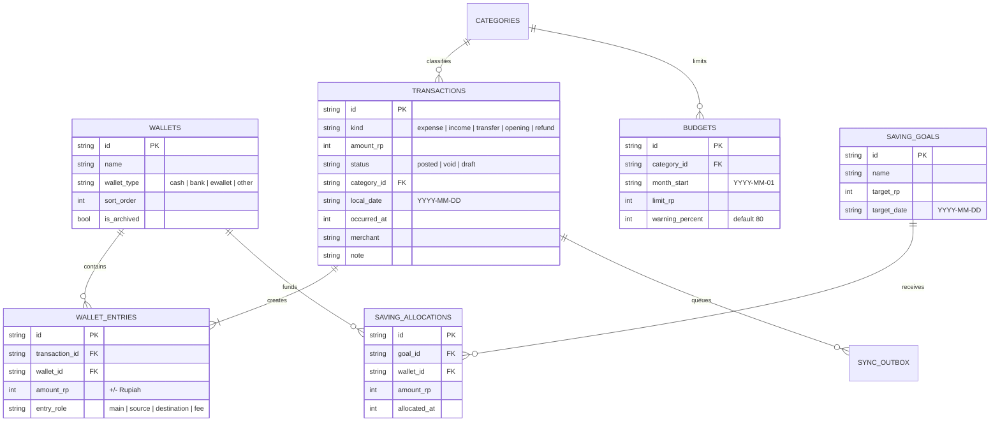

# Laporan Komprehensif Arsitektur & Panduan Fitur Menu Keuangan (Finance Module)
Aplikasi: **Anak Kost** (Dompet Kos)  
Versi Dokumen: **1.0.0**  
Target Pembaca: Pengembang Flutter, AI Coding Assistant, Product Designer, dan QA Engineer.

---

## 1. Ringkasan Eksekutif & Filosofi Desain

Modul Keuangan (**Finance Module**) pada aplikasi **Anak Kost** dirancang dengan pendekatan **Offline-First**, **Double-Entry Ledger (Pembukuan Berpasangan)**, dan **Strict Atomic Consistency**.

### Prinsip Utama:
1. **Tidak Ada Floating-Point untuk Nominal Uang**: Seluruh nilai moneter disimpan dan dihitung dalam tipe data bilangan bulat (`int` Rupiah). Hal ini mencegah akumulasi pembulatan desimal yang sering merusak akurasi saldo keuangan.
2. **Ledger-Based Balance (Bukan Kolom Statis)**: Saldo dompet tidak disimpan sebagai nilai statis yang dimutasi langsung (`wallet.balance = balance + X`), melainkan dihitung secara real-time melalui agregasi SQL:
   $$\text{Saldo Dompet} = \sum (\text{wallet\_entries.amount\_rp}) \quad \text{dimana } \text{status} = \text{'posted'} \land \text{deleted\_at IS NULL}$$
3. **Pencatatan Atomik & Aman Pembatalan (Void-Safe)**: Setiap transaksi mutasi keuangan (Pemasukan, Pengeluaran, Transfer) mencatat entri header dan ledger dalam satu transaksi database atomik SQLite (`_db.transaction`). Pembatalan transaksi tidak menghapus data historis, melainkan mengubah status menjadi `void` sehingga integritas audit dan sinkronisasi tetap terjaga.
4. **Offline-First & Outbox Replication**: Setiap mutasi membuat catatan di tabel `sync_outbox` untuk direplikasi secara asinkron ke Supabase ketika koneksi internet tersedia.

---

## 2. Struktur Direktori & File Modul Keuangan

Modul Keuangan berlokasi di [`lib/features/finance/`](file:///d:/Pemrograman/Aplikasi/AnakKost_Android/lib/features/finance/):

```
lib/features/finance/
├── data/
│   ├── finance_dao.dart           # Data Access Object Drift (Query, Stream, Agregasi Ledger)
│   ├── finance_dao.g.dart         # Kode hasil generate Drift untuk DAO
│   └── finance_repository.dart    # Repositori bisnis, transaksi atomik, & outbox synchronization
├── domain/
│   └── models/
│       └── finance_models.dart    # DTO (Data Transfer Objects): WalletWithBalance, BudgetProgress, dll.
└── presentation/
    ├── add_transaction_screen.dart # Layar pencatatan Pengeluaran (Expense) & Pemasukan (Income)
    ├── finance_screen.dart        # Layar utama modul keuangan (Beranda Keuangan)
    ├── saving_goals_screen.dart   # Layar target tabungan & pengelolaan alokasi dana
    ├── transfer_screen.dart       # Layar transfer dana antar-dompet beserta biaya admin
    ├── providers/
    │   └── finance_providers.dart # Riverpod StreamProviders & StateNotifiers
    └── widgets/
        ├── add_budget_sheet.dart  # Bottom sheet pengaturan batas budget bulanan per kategori
        ├── add_wallet_sheet.dart  # Bottom sheet pembuatan dompet baru
        ├── balance_card.dart      # Kartu saldo utama (Dark Teal) + toggle intip saldo + 4 pill actions
        ├── budget_card_widget.dart# Kartu status anggaran per kategori & indikator peringatan
        ├── finance_chart_widget.dart # Visualisasi grafik batang tren pengeluaran 7 hari (fl_chart)
        ├── recent_transactions_widget.dart # Daftar transaksi terakhir + dialog pembatalan (void)
        └── wallets_list_widget.dart # List horizontal dompet aktif beserta saldo masing-masing
```

---

## 3. Skema Basis Data & Model Relasional

Modul ini memanfaatkan tabel Drift SQLite yang didefinisikan di [`lib/core/database/tables/finance_tables.dart`](file:///d:/Pemrograman/Aplikasi/AnakKost_Android/lib/core/database/tables/finance_tables.dart):



### Penjelasan DTO (Data Transfer Objects):
1. **`WalletWithBalance`**: Menggabungkan data dompet dengan saldo hasil perhitungan agregasi `SUM(wallet_entries.amount_rp)`.
2. **`BudgetProgress`**:
   - `spentRp`: Total pengeluaran aktual kategori pada bulan berjalan.
   - `remainingRp`: Sisa pagu anggaran (`limitRp - spentRp`).
   - `percentage`: Rasio pemakaian anggaran.
   - `isWarning`: `true` jika pemakaian mencapai atau melampaui `warningPercent` (default 80%).
   - `isExceeded`: `true` jika pengeluaran melebihi 100% dari limit anggaran.
3. **`SavingGoalWithProgress`**:
   - `allocatedRp`: Akumulasi alokasi tabungan bersih (`SUM(SavingAllocations.amountRp)`).
   - `remainingRp`: Kekurangan dana untuk mencapai target nominal.
   - `isAchieved`: `true` jika target tabungan telah terpenuhi 100%.
4. **`TransactionWithDetails`**: Objek transaksi lengkap yang sudah di-join dengan entitas Kategori, Dompet Asal, dan Dompet Tujuan.

---

## 4. Fitur-Fitur Menu Keuangan & Penjelasannya

### 4.1. Kartu Saldo Utama & Mode Privasi (`BalanceCard`)
- **Total Saldo Aktif**: Menghitung secara otomatis seluruh saldo dari dompet yang berstatus aktif (`isArchived == false` dan `deletedAt IS NULL`).
- **Privacy Mode (Toggle Mata `••••••••`)**:
  - Dikontrol oleh `balanceVisibilityProvider`.
  - Ketika ikon mata dimatikan, nominal saldo utama dan saldo pada masing-masing dompet disamarkan menjadi titik-titik rahasia (`••••••••`) agar aman saat membuka aplikasi di tempat umum.
- **Aksi Cepat Kapsul (Quick Action Pills)**:
  - **Keluar** (Merah lembut): Membuka form pencatatan Pengeluaran.
  - **Masuk** (Hijau lembut): Membuka form pencatatan Pemasukan.
  - **Transfer** (Biru lembut): Membuka form transfer antar-dompet.
  - **Tabungan** (Kuning emas): Membuka manajemen target tabungan.

### 4.2. Manajemen Multi-Dompet (`WalletsListWidget` & `AddWalletSheet`)
- Pengguna dapat memisahkan penyimpanan uang sesuai bentuk fisiknya:
  - **Dompet Tunai** (Uang kertas / koin di saku atau kamar kos).
  - **Rekening Bank** (BCA, Mandiri, BRI, BNI, Jago, dll.).
  - **E-Wallet** (GoPay, OVO, Dana, ShopeePay, LinkAja).
- **Saldo Awal Otomatis**: Saat menambahkan dompet baru dengan saldo awal $> 0$, sistem otomatis membuat transaksi bertipe `opening` sehingga riwayat mutasi awal tetap tercatat rapi.

### 4.3. Pencatatan Pengeluaran & Pemasukan (`AddTransactionScreen`)
- **Input Fleksibel**:
  - Tombol nominal instan (+10rb, +20rb, +50rb, +100rb) untuk mempercepat input anak kost.
  - Pilihan Dompet sumber dana atau penerima dana.
  - Pilihan Kategori dengan ikon dan warna yang representatif.
  - Input Merchant / Toko (contoh: "Warung Bu Siti", "Indomaret", "Kantin Kampus").
  - Pemilih Tanggal transaksi (`DatePicker`).
  - Kolom Catatan opsional.
- **Validasi Ketat**: Nominal harus $> 0$, dompet dan kategori wajib dipilih.

### 4.4. Transfer Antar-Dompet Atomik & Biaya Admin (`TransferScreen`)
- Digunakan saat menarik uang tunai dari ATM atau melakukan *top-up* e-wallet dari rekening bank.
- **Biaya Transfer (Fee)**: Jika terdapat biaya admin (misal Rp1.000 atau Rp2.500), sistem secara otomatis mencatat 2 hal secara atomik:
  1. Transfer utama: Mengurangi dompet asal dan menambah dompet tujuan.
  2. Pengeluaran biaya: Mengurangi dompet asal sebesar nilai admin dan mencatatnya ke kategori "Biaya Transfer".
- **Validasi**: Dompet asal dan tujuan tidak boleh sama.

### 4.5. Sistem Anggaran Bulanan (`BudgetCardWidget` & `AddBudgetSheet`)
- Mengontrol kebiasaan boros anak kost dengan menetapkan batas pengeluaran per bulan per kategori (misal: "Makan & Minum: Rp1.200.000/bulan").
- **Indikator Visual**:
  - Status Normal: Warna hijau / teal netral.
  - Status Waspada ($> 80\%$): Badge oranye `Hampir Habis`.
  - Status Overbudget ($> 100\%$): Badge merah `Melebihi Anggaran`.

### 4.6. Target Tabungan / Celengan Digital (`SavingGoalsScreen`)
- Pengguna dapat membuat target tabungan tertentu (contoh: "Beli Laptop", "Dana Darurat", "Mudik").
- **Alokasi Dana Virtual**: Dana dialokasikan dari dompet riil ke target tabungan.
  - *Catatan Penting*: Alokasi tidak memotong saldo riil dompet di dunia nyata, melainkan bertindak sebagai penanda komitmen alokasi (earmarked funds).
  - Penarikan alokasi (Withdraw) dapat dilakukan kapan saja jika dana tabungan terpaksa dipakai kembali untuk kebutuhan mendesak.

### 4.7. Riwayat Transaksi & Pembatalan Aman (`RecentTransactionsWidget`)
- Menampilkan daftar transaksi terbaru secara kronologis.
- Pembeda visual jelas:
  - Pemasukan: Simbol `+` dengan warna teks hijau `#1B8755`.
  - Pengeluaran: Simbol `-` dengan warna teks merah `#D32F2F`.
  - Transfer: Simbol `⇄` dengan warna teks biru.
  - Transaksi Batal: Badge merah `Dibatalkan` dan teks tercoret.
- **Mekanisme Pembatalan (Void Transaction)**:
  - Jika pengguna salah memasukkan nominal atau salah pilih dompet, transaksi dapat dibatalkan melalui dialog konfirmasi.
  - Status transaksi berubah menjadi `void`.
  - Saldo dompet dan anggaran bulanan langsung kembali seperti semula tanpa menghapus riwayat audit.

### 4.8. Grafik Tren Pengeluaran 7 Hari (`FinanceChartWidget`)
- Menggunakan visualisasi batang (`fl_chart`) berwarna dark teal `#062F3B`.
- Menghitung akumulasi pengeluaran harian dari 6 hari lalu hingga hari ini.
- Membantu anak kost mengevaluasi lonjakan pengeluaran dalam sepekan terakhir.

---

## 5. Panduan Cara Pemakaian (User Guide & Workflow)

### Alur 1: Memeriksa dan Menyesuaikan Dompet
1. Buka tab navigasi **Keuangan** di bilah bawah aplikasi.
2. Periksa **Total Saldo Aktif** di kartu atas. Ketuk ikon mata untuk menyembunyikan atau melihat nominal saldo.
3. Di bagian **Daftar Dompet**, geser horizontal untuk melihat saldo masing-masing dompet.
4. Untuk menambah dompet baru (misal: "ShopeePay"):
   - Ketuk tombol **+ Tambah** di kanan atas daftar dompet.
   - Masukkan nama dompet, pilih tipe (Tunai / Bank / E-Wallet), dan isi saldo awal jika ada.
   - Ketuk **Simpan Dompet**.

### Alur 2: Mencatat Pengeluaran Harian
1. Pada kartu saldo atas, ketuk tombol kapsul **Keluar**.
2. Masukkan nominal pengeluaran (atau gunakan tombol instan seperti `+20rb`).
3. Pilih **Dompet** sumber pembayaran (misal: "Dompet Tunai").
4. Pilih **Kategori** yang sesuai (misal: "Makan & Minum").
5. Isi nama toko/warung (misal: "Kantin") dan catatan jika diperlukan.
6. Ketuk tombol **Simpan Pengeluaran**.
7. Saldo dompet dan progres anggaran bulanan akan langsung terpotong secara instan.

### Alur 3: Mencatat Pemasukan (Kiriman Uang / Gaji)
1. Pada kartu saldo atas, ketuk tombol kapsul **Masuk**.
2. Masukkan nominal uang yang diterima.
3. Pilih dompet penampung (misal: "Rekening Bank").
4. Pilih kategori pemasukan (misal: "Kiriman Ortu" atau "Gaji").
5. Ketuk **Simpan Pemasukan**. Saldo total akan langsung bertambah.

### Alur 4: Mentransfer Saldo Antar-Dompet
1. Ketuk tombol kapsul **Transfer** pada kartu saldo atas.
2. Pilih **Dompet Asal** (misal: "Rekening Bank").
3. Pilih **Dompet Tujuan** (misal: "E-Wallet").
4. Masukkan nominal transfer.
5. Jika ada biaya admin (misal: Rp1.000), isi pada kolom Biaya Admin.
6. Ketuk **Kirim Transfer**. Saldo bank berkurang dan saldo e-wallet bertambah secara bersamaan.

### Alur 5: Mengatur Batas Anggaran Bulanan
1. Pada kartu **Anggaran Bulan Ini**, ketuk tombol **Atur**.
2. Pilih kategori yang ingin dibatasi (misal: "Belanja Harian").
3. Masukkan batas nominal bulanan (misal: Rp500.000).
4. Tentukan batas persentase peringatan (default 80%).
5. Ketuk **Simpan Anggaran**. Kartu progres akan otomatis menampilkan sisa saldo anggaran Anda.

### Alur 6: Membatalkan Transaksi yang Salah (Void)
1. Gulir ke bagian **Transaksi Terakhir**.
2. Ketuk baris transaksi yang salah dimasukkan.
3. Muncul dialog konfirmasi **Batalkan Transaksi?**.
4. Ketuk **Ya, Batalkan**.
5. Transaksi akan ditandai berstatus `void`, saldo dompet pulih kembali, dan anggaran terkait disesuaikan otomatis.

---

## 6. Arsitektur State Management & Panduan Riverpod

Modul ini mengandalkan Riverpod untuk reaktivitas data yang efisien dan bersih. Berikut daftar provider di [`finance_providers.dart`](file:///d:/Pemrograman/Aplikasi/AnakKost_Android/lib/features/finance/presentation/providers/finance_providers.dart):

| Provider Name | Tipe Provider | Fungsi / Nilai Balikan |
| :--- | :--- | :--- |
| `financeRepositoryProvider` | `Provider<FinanceRepository>` | Singleton instance repository bisnis keuangan. |
| `financeDaoProvider` | `Provider<FinanceDao>` | Accessor langsung ke fungsi query database Drift. |
| `totalBalanceStreamProvider` | `StreamProvider<int>` | Stream saldo total seluruh dompet aktif secara real-time. |
| `walletsStreamProvider` | `StreamProvider<List<WalletWithBalance>>` | Stream daftar dompet aktif beserta saldo berjalan masing-masing. |
| `categoriesStreamProvider` | `StreamProvider.family<List<Category>, String?>` | Stream kategori berdasar filter arah (`expense`/`income`/`null`). |
| `transactionsStreamProvider` | `StreamProvider.family<List<TransactionWithDetails>, TransactionFilterParams>` | Stream daftar riwayat transaksi dengan filter dompet, kategori, bulan, dan limit. |
| `budgetProgressStreamProvider` | `StreamProvider.family<List<BudgetProgress>, String>` | Stream pemantauan limit anggaran bulan berjalan per kategori. |
| `savingGoalsStreamProvider` | `StreamProvider<List<SavingGoalWithProgress>>` | Stream seluruh target tabungan beserta akumulasi alokasi dana. |
| `balanceVisibilityProvider` | `NotifierProvider<BalanceVisibilityNotifier, bool>` | State toggle menyembunyikan atau menampilkan nominal saldo. |

---

## 7. Aturan Bisnis & Penanganan Edge Cases

1. **Pencegahan Saldo Negatif**:
   - Sistem tidak memblokir saldo kas menjadi minus jika terjadi pengeluaran darurat, namun menampilkan indikator peringatan visual agar pengguna menyadari defisit kas.
   - Pada alokasi tabungan (`allocateSavings`), sistem **wajib memvalidasi** bahwa saldo dompet asal mencukupi sebelum alokasi disetujui.
2. **Kategori Sistem Bawaan**:
   - Jika database baru pertama kali dijalankan, fungsi `seedDefaultsIfEmpty()` secara otomatis menyediakan:
     - 3 Dompet awal: *Dompet Tunai*, *Rekening Bank*, *E-Wallet*.
     - 6 Kategori Pengeluaran: *Makan & Minum*, *Kost & Tagihan*, *Transportasi*, *Belanja Harian*, *Biaya Transfer*, *Lain-lain*.
     - 3 Kategori Pemasukan: *Gaji / Upah Magang*, *Kiriman Ortu*, *Bonus / Lainnya*.
3. **Pencatatan Biaya Transfer Independen**:
   - Biaya admin transfer dibuat sebagai transaksi `expense` terpisah berelasi dengan `fee_tx_id` sehingga perhitungan laporan pengeluaran bulanan tetap akurat memasukkan biaya admin perbankan.

---

## 8. Verifikasi & Pengujian Otomatis

Modul Keuangan telah diuji secara komprehensif melalui test suite di `test/`:
- **`test/features/finance/finance_screen_test.dart`**: Memverifikasi render antarmuka beranda keuangan, visibilitas saldo aktif, daftar dompet, kartu budget, dan respons tombol.
- **`test/features/finance/finance_dao_test.dart`**: Memvalidasi akurasi perhitungan agregasi ledger `SUM(wallet_entries.amount_rp)`, mutasi transfer atomik, dan keamanan pembatalan transaksi (void).
- **`test/widget_test.dart`**: Memastikan navigasi tab Keuangan terintegrasi sempurna dengan shell aplikasi dan navigasi kapsul melayang.

---
*Dokumen ini diperbarui secara otomatis dan dijadikan acuan standar implementasi fitur keuangan aplikasi Anak Kost.*
